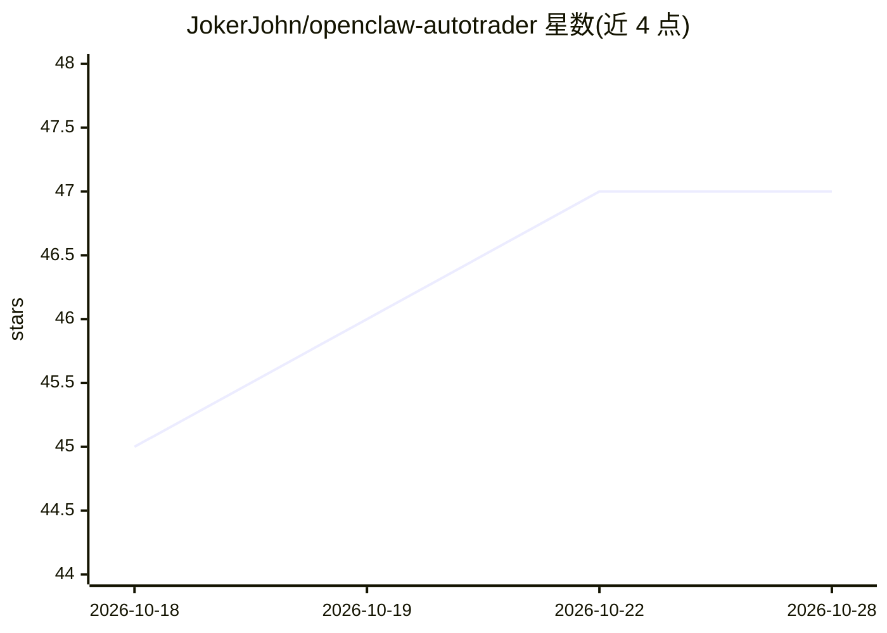

# JokerJohn/openclaw-autotrader

⭐ 47 · JavaScript · 推送 2026-10-28 · [GitHub](https://github.com/JokerJohn/openclaw-autotrader) · 个人维护 · 中文 README

**公开记录 AI 交易代理 30 天美股实盘挑战的日志仓库**

JokerJohn 维护的公开实盘挑战记录仓库：一只 OpenClaw 🦞 交易代理以 10000 HKD 起步资金挑战美股市场（必要時监控港股），仓库持续公开决策状态、每日报告、持仓状态、交易规则与调整（白名单、不加杠杆、不做空、单日亏损止损线）以及沉淀为可复用经验的学习日志（短记忆/长记忆文档）。仓库本身不提供可安装的软件，仅发布运行记录与操作规则文档。

## 筛选速览

| 维度 | 判定 | 备注 |
|---|---|---|
| AI 角色 | `ai-knowledge` | 知识聚合/清单类 |
| 许可风险 | `none` | — |
| 部署形态 | `None` |  |
| 模型依赖 | — | README 未给出锁定关系 |
| 硬件要求 | — | 无带数字的原话,不猜 |
| 安装摩擦 | `low` | 无编译、无系统依赖或容器化 |
| 成熟度 | — | 结构信号不足 |

## 能力要点

- 公开实盘决策、每日报告与监控快照
- 交易约束规则公开：白名单、无杠杆、无做空、单日亏损 HKD 5000 止损
- 学习日志分短记忆/长记忆文档持续更新
- 只披露策略、持仓状态、决策状态与每日交易活动

## 适用场景

- 跟踪 AI 交易代理在美股的公开实盘表现
- 查看代理如何把交易经验沉淀为可复用教训
- 了解一套公开的自动化交易约束规则设计

## 场景标签

`金融量化` · 领域:学习与行业

## 证据(README 行号)

> L12: - a real 30-day live challenge, not backtest theater / 一个真实连续 30 天的实盘挑战，不是回测表演
> L34: Follow how the 🦞 claw turns finished trades, missed timing, and quiet sessions into reusable lessons.

## 星数曲线

2026-10-18 45 → 2026-10-28 47（+2）

---
*卡片 v1 · prompt 1.4 · 生成 2026-10-25 · 置信度 mid · 依据 README sha `03f69471b483` · [字段定义](../../DATASET.md)*
