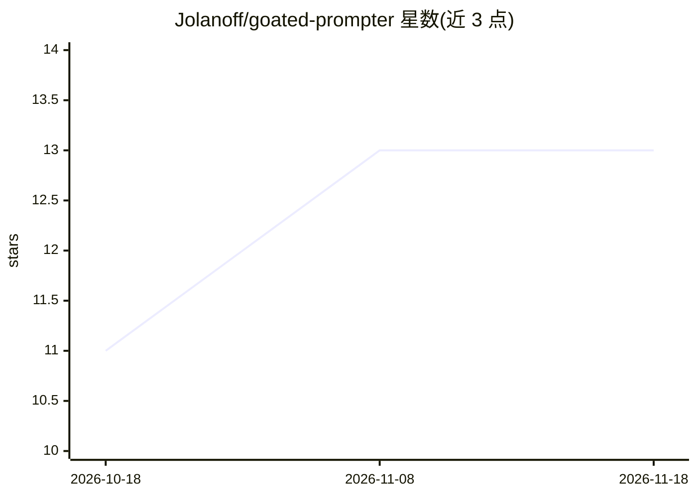

# Jolanoff/goated-prompter

⭐ 13 · Python · NOASSERTION · 推送 2026-10-29 · [GitHub](https://github.com/Jolanoff/goated-prompter) · 个人维护

**本地提示词工作台：为图像/视频模型生成可复制提示词**

由 React 前端与 Python 后端组成的本地提示词生成工具，配合 llama.cpp 或 OpenAI 兼容端点的语言/视觉模型运行。提供 Prompt Builder（文本加最多四张参考图）、Refine、MiniMax H3 视频提示词（含符号引用与输出校验）、面向 LoRA 训练的数据集批量生成（1-25 条，TXT/JSON 导出）、提示词库与保存管理。针对 FLUX.2 Klein、Qwen Image、Krea 2、Ideogram、LTX 2.5 等目标模型适配输出结构与语法。应用只产出提示词文本，不生成图像或视频，模型权重需另行下载。

## 筛选速览

| 维度 | 判定 | 备注 |
|---|---|---|
| AI 角色 | `ai-native` | 本体是模型或模型工具 |
| 许可风险 | `none` | NOASSERTION |
| 部署形态 | `desktop` | 安装包/桌面程序 |
| 模型依赖 | local-ok | 支持本地模型 |
| 硬件要求 | — | 无带数字的原话,不猜 |
| 安装摩擦 | `medium` | 含编译或系统依赖之一 |
| 成熟度 | — | 结构信号不足 |

## 能力要点

- 面向多目标模型的适配器：按各自文档化格式输出（如 Anima 标签顺序、Ideogram caption schema）
- MiniMax H3 工作流：符号引用 token、clip 时长、输出分节/帧对齐校验与一次修复
- 数据集工作流：一次请求生成 1-25 条变体提示词用于 LoRA 训练，支持种子与词表包
- 本地 llama.cpp 或 OpenAI 兼容端点双推理路径，支持任务取消

## 适用场景

- 为 FLUX/Qwen/Krea 等图像模型编写结构合规的提示词
- 为 LoRA 训练批量生成图像描述数据集
- 撰写 MiniMax H3 视频提示词并校验引用格式

## 场景标签

`提示工程` · 领域:Agent 开发

## 证据(README 行号)

> L5: A local prompt studio for image and video workflows.
> L15: Goated Prompter pairs a **React + Tailwind interface** with a **Python backend** and a language/vision model. Contr
> L18: > **This app writes prompts, not images or videos.** Copy the output into your preferred generation tool. Model wei

## 星数曲线

2026-10-18 11 → 2026-11-18 13（+2）

---
*卡片 v1 · prompt 1.4 · 生成 2026-11-18 · 置信度 high · 依据 README sha `4dd49ab04ed1` · [字段定义](../../DATASET.md)*
