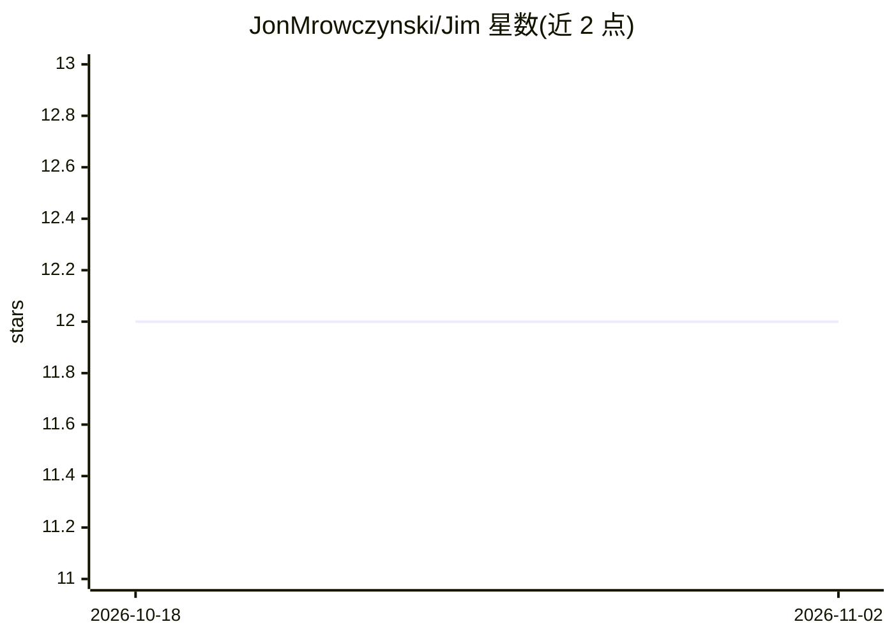

# JonMrowczynski/Jim

⭐ 12 · Java · MIT · 推送 2026-05-25 · [GitHub](https://github.com/JonMrowczynski/Jim) · 个人维护

**情感 AI 机器人平台：可对话、表达并识别人脸情绪**

Jim 是一个跨学科低成本情感 AI 机器人平台，包含电子电路、固件、主控软件与 Kinect 软件四个子项目。机器人具备三项主要功能：说话、表达、通过 Kinect One 传感器与 AI 从人脸表情解读基本人类情绪。主控软件需 OpenJDK/OpenJFX 11 与 USB to MIDI 线缆；Kinect 部分需 Kinect for Windows SDK 2.0、Visual Studio 2019 及 Xbox Kinect One 传感器与适配器。文档夹内含 Jim/EDDIE 的附加资料，EDDIE 为其后续形态。

## 筛选速览

| 维度 | 判定 | 备注 |
|---|---|---|
| AI 角色 | `ai-native` | 本体是模型或模型工具 |
| 许可风险 | `permissive` | MIT |
| 部署形态 | `None` |  |
| 模型依赖 | — | README 未给出锁定关系 |
| 硬件要求 | — | 无带数字的原话,不猜 |
| 安装摩擦 | `medium` | 含编译或系统依赖之一 |
| 成熟度 | — | 结构信号不足 |

## 能力要点

- 说话、表达、解读基本人类情绪三项功能
- Kinect One 传感器数据经 AI 解读面部表情情绪
- 分电子、固件、主控、Kinect 四个子项目组织

## 适用场景

- 搭建或复现一个情感机器人实验平台
- 跨学科课程或研究中演示情感 AI
- 参考其电路、固件与 Kinect 情绪识别实现

## 场景标签

`聊天机器人` `人脸识别` · 领域:对话与助手

## 证据(README 行号)

> L3: An inexpensive interdisciplinary platform for affective AI, Jim the robot has the ability to talk, express, and inte
> L7: The Kinect Software subproject is required to operate the third main functionality. An AI is used to interpret the d

## 星数曲线

2026-10-18 12 → 2026-11-02 12（+0）

---
*卡片 v1 · prompt 1.4 · 生成 2026-11-01 · 置信度 high · 依据 README sha `b756764a243d` · [字段定义](../../DATASET.md)*
