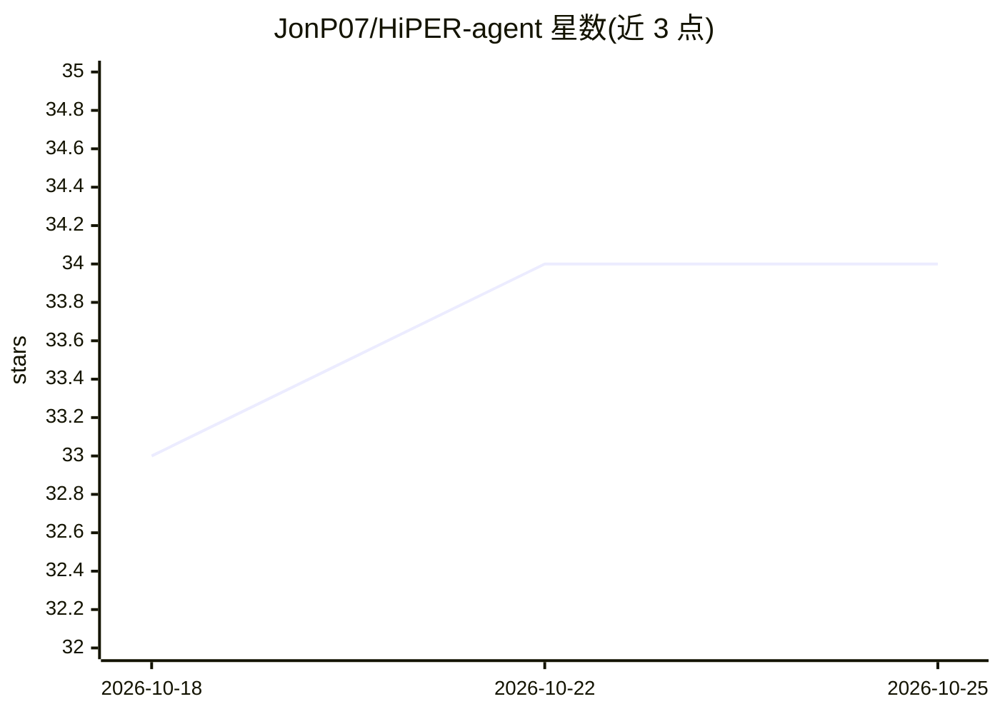

# JonP07/HiPER-agent

⭐ 34 · Python · Apache-2.0 · 推送 2026-06-24 · [GitHub](https://github.com/JonP07/HiPER-agent) · [官网](https://arxiv.org/abs/2602.16165) · 组织维护

**训练 LLM 智能体的分层强化学习框架（论文官方实现）**

ICML 2026 论文 HiPER 的官方实现：面向长时序环境中大语言模型智能体的分层强化学习训练框架，将高层规划与低层执行显式分离，并提出 Hierarchical Advantage Estimation (HAE) 做多时间尺度的信用分配。代码基于 verl-agent/veRL 构建，扩展了智能体接口与训练算法；提供 ALFWorld 与 WebShop 两个环境下的安装与训练脚本，报告 Qwen2.5-1.5B/7B 的成功率结果。安装需分别建立 conda 环境（WebShop 要求 Python≤3.10）。

## 筛选速览

| 维度 | 判定 | 备注 |
|---|---|---|
| AI 角色 | `ai-ecosystem` | LLM/agent 周边工具 |
| 许可风险 | `permissive` | Apache-2.0 |
| 部署形态 | `library` | 以包/库形式分发 |
| 模型依赖 | — | README 未给出锁定关系 |
| 硬件要求 | — | 无带数字的原话,不猜 |
| 安装摩擦 | `medium` | 含编译或系统依赖之一 |
| 成熟度 | — | 结构信号不足 |

## 能力要点

- 高层规划与低层执行分离的分层 RL 训练框架
- Hierarchical Advantage Estimation (HAE) 多时间尺度信用分配
- 基于 verl-agent/veRL 构建，扩展智能体接口与训练算法
- 提供 ALFWorld 与 WebShop 环境的安装与训练脚本

## 适用场景

- 在 ALFWorld/WebShop 等长时序环境中做 LLM 智能体 RL 训练
- 复现论文中 Qwen2.5 各规模的实验结果
- 基于分层信用分配方法开展智能体训练研究

## 场景标签

`强化学习` · 领域:训练与推理

## 证据(README 行号)

> L9: HiPER is a hierarchical reinforcement learning framework for training large language model agents in long-horizon en

## 星数曲线

2026-10-18 33 → 2026-10-25 34（+1）

---
*卡片 v1 · prompt 1.4 · 生成 2026-10-25 · 置信度 mid · 依据 README sha `32bad54c6e9d` · [字段定义](../../DATASET.md)*
