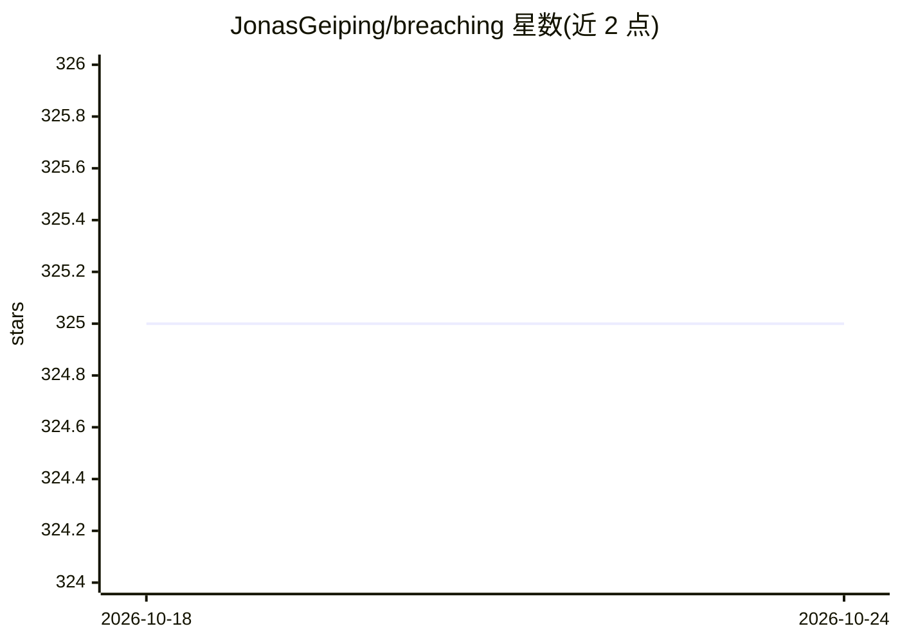

# JonasGeiping/breaching

⭐ 327 · Python · MIT · 推送 2026-01-24 · [GitHub](https://github.com/JonasGeiping/breaching) · 组织维护

**联邦学习隐私攻击框架：从梯度更新重建用户数据**

基于 PyTorch 的研究框架，实现一系列针对联邦学习的梯度反演攻击，通过仅依赖用户上传到服务器的更新数据重建图像或文本等用户数据。覆盖恶意模型攻击、Decepticons、Fishing 及优化类/解析类/递归攻击。框架由 attacks 与 cases 两部分组成，攻击与用例解耦，经 hydra 配置可扩展；FL 模拟为“浅层”（不实际训练，使用固定 checkpoint），不实现防御。供隐私审计与安全研究人员使用。

## 筛选速览

| 维度 | 判定 | 备注 |
|---|---|---|
| AI 角色 | `ai-native` | 本体是模型或模型工具 |
| 许可风险 | `permissive` | MIT |
| 部署形态 | `library` | 以包/库形式分发 |
| 模型依赖 | — | README 未给出锁定关系 |
| 硬件要求 | — | 无带数字的原话,不猜 |
| 安装摩擦 | `low` | 无编译、无系统依赖或容器化 |
| 成熟度 | — | 结构信号不足 |

## 能力要点

- 攻击与用例模块化解耦，经 hydra 配置定制扩展
- 覆盖视觉与语言两类场景的多种梯度反演攻击
- 内置 benchmark_breaches.py 批量评测脚本与多维指标（CW-SSIM、R-PSNR 等）
- 威胁模型显式化，攻击者仅可访问 shared_user_data

## 适用场景

- 评估联邦学习方案在梯度反演攻击下的隐私泄露风险
- 复现与对比多篇隐私攻击论文的方法
- 开发新的攻击或用例并做定量基准测试

## 场景标签

`网络安全` · 领域:学习与行业

## 证据(README 行号)

> L3: This PyTorch framework implements a number of gradient inversion attacks that *breach* privacy in federated learning
> L46: reconstructed_user_data, stats = attacker.reconstruct(payloads, shared_user_data)
> L52: This framework is modular collections of attacks against federated learning that breach privacy by recovering user 

## 星数曲线

2026-10-18 325 → 2026-10-24 325（+0）

---
*卡片 v1 · prompt 1.4 · 生成 2026-10-21 · 置信度 high · 依据 README sha `5ec8b80e7675` · [字段定义](../../DATASET.md)*
