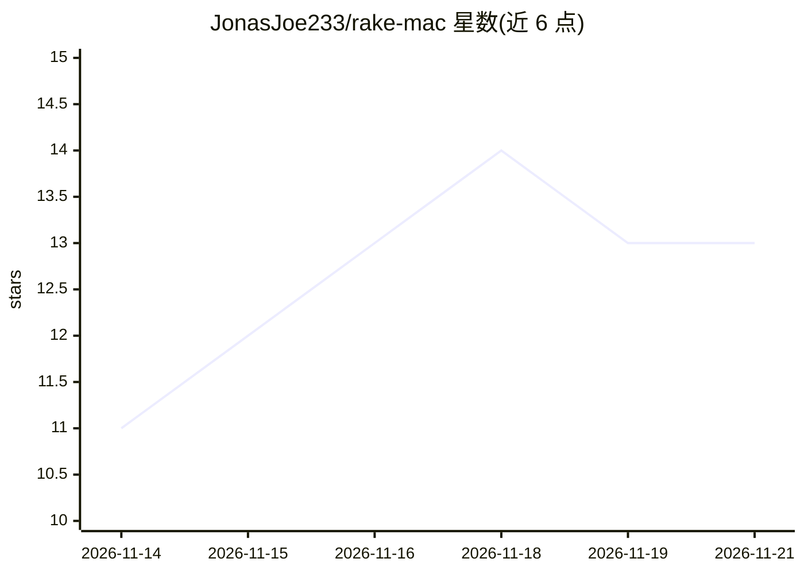

# JonasJoe233/rake-mac

⭐ 13 · Swift · MIT · 推送 2026-11-13 · [GitHub](https://github.com/JonasJoe233/rake-mac) · [官网](https://jonasjoe233.github.io/rake-mac/) · 个人维护

**macOS 磁盘清理工具：绘制磁盘地图并安全删除缓存**

Rake 是一款离线运行的 macOS 磁盘空间分析与清理工具：将整个磁盘绘制为一张地图展示空间占用，标记可安全清理的部分，用户勾选确认后才执行删除，删除项进入废纸篓。定位为 AI agent 用户场景——AI 代理因沙箱限制无法清理沙箱外文件，Rake 作为人工确认的清理手段。提供 Rake.dmg 安装包（macOS 13+，支持 Apple silicon 与 Intel）与终端安装脚本，源码构建需 Swift 工具链。MIT 许可，未签名证书首次打开需手动放行。

## 筛选速览

| 维度 | 判定 | 备注 |
|---|---|---|
| AI 角色 | `ai-enhanced` | 去掉 AI 部分产品仍成立 |
| 许可风险 | `permissive` | MIT |
| 部署形态 | `desktop` | 安装包/桌面程序 |
| 模型依赖 | — | README 未给出锁定关系 |
| 硬件要求 | — | 无带数字的原话,不猜 |
| 安装摩擦 | `low` | 无编译、无系统依赖或容器化 |
| 成熟度 | — | 结构信号不足 |

## 能力要点

- 磁盘整体地图可视化与空间占用分析
- 仅删除用户确认的条目，其余进废纸篓
- iCloud Drive、照片、钥匙串与备份不受触碰
- 完全离线运行，MIT 开源

## 适用场景

- 清理 AI agent 与开发产生的缓存占用磁盘空间
- 查找并确认可安全删除的大文件与缓存
- 在离线环境下清理 Mac 存储空间

## 场景标签

 · 领域:系统工具/磁盘管理

## 证据(README 行号)

> L15: Rake draws your whole disk as one map, so you see what is taking the space.
> L13: - You asked your AI agent to clean up. It can't touch files outside its sandbox.

## 星数曲线

2026-11-14 11 → 2026-11-21 13（+2）

---
*卡片 v1 · prompt 1.4 · 生成 2026-11-18 · 置信度 high · 依据 README sha `8e4cc0e8e8b7` · [字段定义](../../DATASET.md)*
