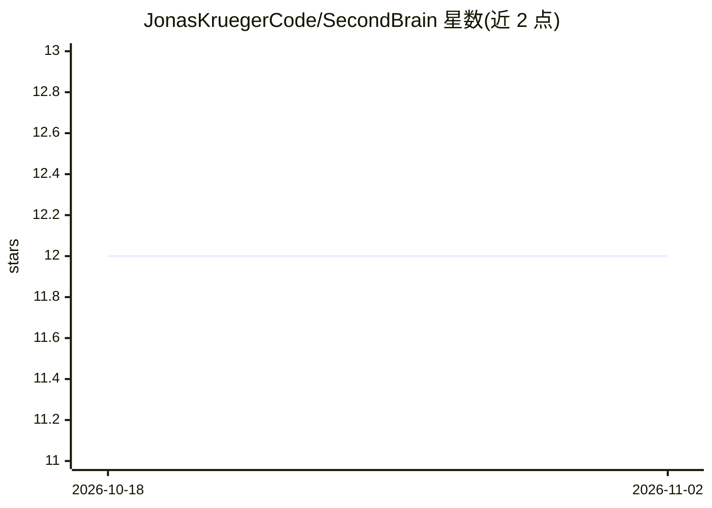

# JonasKruegerCode/SecondBrain

⭐ 12 · Python · MIT · 推送 2026-10-30 · [GitHub](https://github.com/JonasKruegerCode/SecondBrain) · 个人维护

**面向 MCP 智能体的持久记忆服务器：跨会话存取知识**

自托管的 MCP 记忆层：任何 MCP 兼容的 agent（claude.ai、OpenClaw 等）通过 remember/recall 两个 MCP 工具存取知识。remember 将输入拆分为独立主题，由 LLM 规划 agent 以 Wikipedia 式流程写入 Markdown wiki 页（可 Git 同步，Obsidian 兼容），并更新 Neo4j 知识图谱与 Qdrant 向量索引；recall 以 HybridRAG（向量检索+图遍历+LLM 综合）返回答案。LLM 经 OpenRouter 或 GCP 提供，需自备 API key；整套服务以 Docker Compose 部署，含每小时自动整理页面的修复 agent 与 Web UI。

## 筛选速览

| 维度 | 判定 | 备注 |
|---|---|---|
| AI 角色 | `ai-ecosystem` | LLM/agent 周边工具 |
| 许可风险 | `permissive` | MIT |
| 部署形态 | `self-host` | docker 或自建部署 |
| 模型依赖 | locked-api |  |
| 硬件要求 | — | 无带数字的原话,不猜 |
| 安装摩擦 | `low` | 无编译、无系统依赖或容器化 |
| 成熟度 | — | 结构信号不足 |

## 能力要点

- MCP-native：接入 claude.ai、OpenClaw 或任意 MCP 客户端
- HybridRAG：Qdrant 向量检索 + Neo4j 图遍历 + LLM 综合
- Markdown vault 兼容 Obsidian，可 Git 同步到 GitHub/Bitbucket/GitLab/Gitea
- 每小时修复 agent：合并重复、标记矛盾、补充缺失链接

## 适用场景

- 让我的 AI agent 在会话之间保留和回忆学到的知识
- 为多个 MCP 兼容客户端共享同一个自托管知识库
- 用 Obsidian 直接阅读 agent 积累的 wiki 笔记

## 场景标签

`知识库管理` `Agent 记忆` · 领域:Agent 开发

## 证据(README 行号)

> L3: > A persistent MCP memory layer for AI agents. Store knowledge across sessions, retrieve it semantically, and connec
> L11: AI agents are stateless by default — they forget everything when a session ends. SecondBrain solves this by providi
> L24: - **MCP-native** — plug into claude.ai, OpenClaw, or any MCP client

## 星数曲线

2026-10-18 12 → 2026-11-02 12（+0）

---
*卡片 v1 · prompt 1.4 · 生成 2026-11-01 · 置信度 high · 依据 README sha `5fa21a277867` · [字段定义](../../DATASET.md)*
