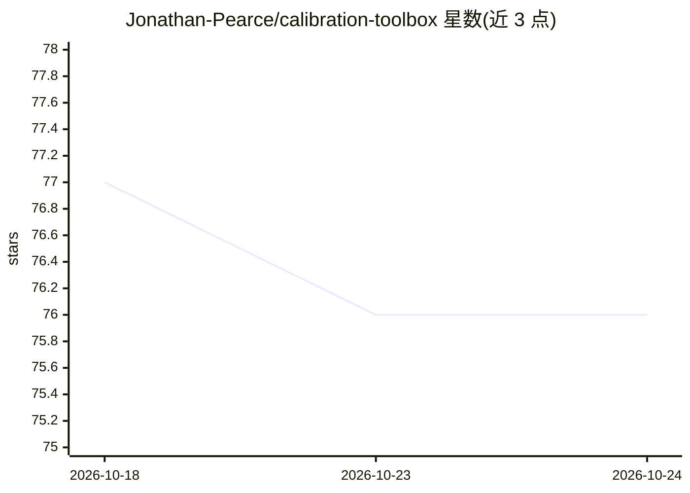

# Jonathan-Pearce/calibration-toolbox

⭐ 76 · Python · MIT · 推送 2026-04-27 · [GitHub](https://github.com/Jonathan-Pearce/calibration-toolbox) · [官网](https://jonathan-pearce.github.io/calibration-toolbox/) · 个人维护

**面向深度学习研究者的模型校准评估 Python 库**

基于 NumPy 的机器学习模型校准评估库：提供 ECE、MCE、RMSCE、ACE、SCE、Top-k 校准误差、过置信误差等基于分箱的校准指标，以及可参数化配置的通用校准误差框架 GCE；附带可靠性图、置信度直方图、逐类校准曲线等可视化工具。框架无关，仅操作 NumPy 数组，不依赖 PyTorch 或 TensorFlow。实现参考近年校准研究论文，面向深度学习与不确定性量化研究场景；PyPI 包与在线文档标注为尚未发布状态。

## 筛选速览

| 维度 | 判定 | 备注 |
|---|---|---|
| AI 角色 | `ai-ecosystem` | LLM/agent 周边工具 |
| 许可风险 | `permissive` | MIT |
| 部署形态 | `library` | 以包/库形式分发 |
| 模型依赖 | — | README 未给出锁定关系 |
| 硬件要求 | — | 无带数字的原话,不猜 |
| 安装摩擦 | `low` | 无编译、无系统依赖或容器化 |
| 成熟度 | — | 结构信号不足 |

## 能力要点

- ECE/MCE/RMSCE/ACE/SCE/Top-k/OE 等多种分箱校准指标
- 可参数化配置的通用校准误差框架 GCE（范数 1/2/∞）
- 可靠性图、置信度直方图、逐类校准曲线等可视化
- 仅依赖 NumPy 数组，无需 PyTorch/TensorFlow，支持 logits 输入

## 适用场景

- 评估分类模型的预测置信度与实际准确率的匹配程度
- 用可靠性图等可视化诊断模型过置信或欠置信
- 研究中对比不同模型或重校准方法的校准质量

## 场景标签

`模型评测` `科研工具` · 领域:评测与运维

## 证据(README 行号)

> L6: **Calibration Toolbox** is a Python library for evaluating machine learning model calibration using binning-based me
> L15: - **Research-Oriented**: Implementations based on recent research papers

## 星数曲线

2026-10-18 77 → 2026-10-24 76（-1）

---
*卡片 v1 · prompt 1.4 · 生成 2026-10-24 · 置信度 high · 依据 README sha `5ec4796ce2d1` · [字段定义](../../DATASET.md)*
