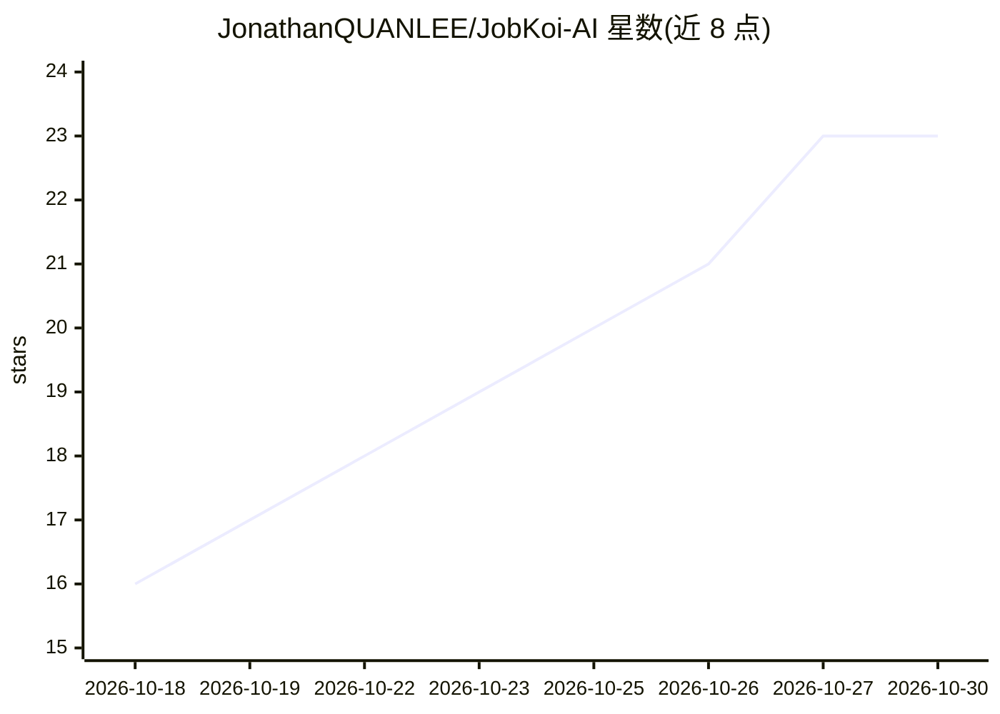

# JonathanQUANLEE/JobKoi-AI

⭐ 23 · Python · MIT · 推送 2026-10-20 · [GitHub](https://github.com/JonathanQUANLEE/JobKoi-AI) · [官网](https://jonathanquanlee.github.io/bosszhipin-job-bot-site/) · 个人维护 · 中文 README

**求职者的多平台自动化投递桌面客户端，带 AI 管家与简历精修**

基于 Tauri 2 + React 18 + Python 3.11 的桌面客户端，面向在 BOSS直聘、猎聘、51Job 求职的个人用户。通过独立的受控 Chrome 会话（CDP 挂接）执行自动化投递巡航，采用高斯随机延迟、多档位节奏、跨页退避与 Code=37 冷却熔断等拟人策略应对平台风控；本地保存全部 Cookie 与数据，无中央服务器。内置 AI 管家（智谱 GLM-4-Flash / OpenRouter / SiliconFlow / OpenAI 兼容端点）支持自然语言调控与求职建议，另提供 STAR 原则简历精修与前后对比视图。Windows 提供安装包，macOS 需从源码构建（Rust/Node/pnpm/uv）。

## 筛选速览

| 维度 | 判定 | 备注 |
|---|---|---|
| AI 角色 | `ai-native` | 本体是模型或模型工具 |
| 许可风险 | `permissive` | MIT |
| 部署形态 | `desktop` | 安装包/桌面程序 |
| 模型依赖 | locked-api |  |
| 硬件要求 | — | 无带数字的原话,不猜 |
| 安装摩擦 | `low` | 无编译、无系统依赖或容器化 |
| 成熟度 | — | 结构信号不足 |

## 能力要点

- BOSS直聘/猎聘/51Job 三平台并发自动化巡航，平台间会话隔离
- 高斯延迟、阶梯退避、Code=37 熔断恢复等拟人防封策略
- AI 管家支持多模型供应商（GLM-4-Flash/OpenRouter/SiliconFlow/OpenAI 兼容端点）切换
- STAR 原则简历重构、量化打磨与前后对比雷达图，全部数据本地保存

## 适用场景

- 在多个招聘平台自动投递简历，减少重复操作
- 担心账号触发风控时用拟人节奏投递
- 让 AI 按目标岗位精修简历并注入 ATS 关键词
- 通过自然语言指挥助手调整投递策略与查询进度

## 场景标签

`浏览器自动化` `AI 写作` `AI 助手` · 领域:效率与自动化

## 证据(README 行号)

> L49: ### 4. AI 智能管家与沉浸式陪伴 (Copilot)
> L55:  - 任意兼容 OpenAI 协议的自定义端点（DeepSeek、Claude、GPT-4o 等）；

## 星数曲线

2026-10-18 16 → 2026-10-30 23（+7）

---
*卡片 v1 · prompt 1.4 · 生成 2026-10-27 · 置信度 high · 依据 README sha `024ade0f85be` · [字段定义](../../DATASET.md)*
