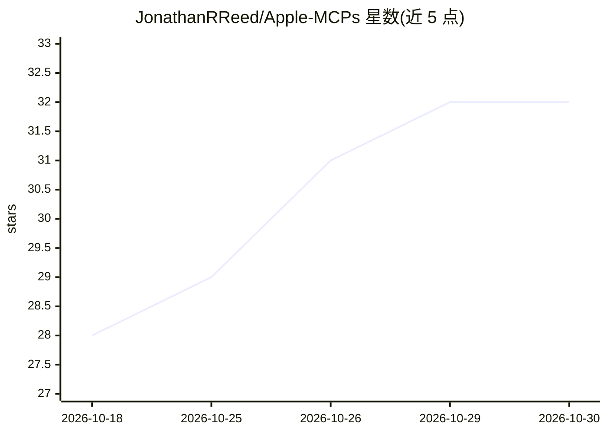

# JonathanRReed/Apple-MCPs

⭐ 32 · Python · MIT · 推送 2026-10-26 · [GitHub](https://github.com/JonathanRReed/Apple-MCPs) · [官网](https://jonathanrreed.com/projects/apple-mcps/) · 个人维护

**让 AI agent 经 MCP 操作 macOS 应用（邮件/日历/短信等）的服务器**

一组 MCP 服务器，为 AI 客户端提供对 macOS 十个应用的本地访问：Mail、Calendar、Reminders、Messages、Contacts、Notes、Shortcuts、Files、System 和 Maps，可创建提醒、发消息、查日历、搜邮件、管理文件、获取路线。提供合并全部应用的统一服务器 Apple-Tools-MCP 及按应用拆分的独立服务器。经 uvx/uv 安装运行，Claude Desktop 也可用 Releases 中的 .mcpb 安装包。每域有安全模式（safe_readonly 等）、健康检查与权限指引工具；HTTP 传输仅允许本机绑定，无远程认证。需 macOS 与 Python 3.11+。

## 筛选速览

| 维度 | 判定 | 备注 |
|---|---|---|
| AI 角色 | `ai-ecosystem` | LLM/agent 周边工具 |
| 许可风险 | `permissive` | MIT |
| 部署形态 | `library` | 以包/库形式分发 |
| 模型依赖 | — | README 未给出锁定关系 |
| 硬件要求 | — | 无带数字的原话,不猜 |
| 安装摩擦 | `low` | 无编译、无系统依赖或容器化 |
| 成熟度 | — | 结构信号不足 |

## 能力要点

- 覆盖 10 个 macOS 应用的统一服务器 + 单应用独立服务器两种形态
- 按域配置安全模式（如 Mail 的 safe_manage/full_access），带审计与撤销记录
- 支持 stdio 与 Streamable HTTP（仅限本机绑定），提供 search_tools 工具发现
- 提供日报/周报生成、通信分诊等跨应用工作流工具

## 适用场景

- 让 Claude Code、Codex 等 MCP 客户端代为收发邮件、管理日程与提醒
- 通过 iMessage/SMS/RCS 发送消息或整理通讯记录
- 限定目录白名单下让 agent 读写文件、执行快捷指令
- 用自然语言生成每日/每周简报并跨应用整理待办

## 场景标签

 · 领域:macOS 自动化/AI agent 基础设施

## 证据(README 行号)

> L7: MCP servers that let an AI client use Apple apps and macOS tools. Create reminders, send messages, check calendars, 
> L11: Requires Python 3.11+ and macOS. Uses MCP specification `2026-07-28` and Python SDK 2.x, with support for older cli
> L40: Run `uvx apple-tools-mcp` to start the server directly. Standalone servers use the same approach, such as `uvx appl

## 星数曲线

2026-10-18 28 → 2026-10-30 32（+4）

---
*卡片 v1 · prompt 1.4 · 生成 2026-10-26 · 置信度 mid · 依据 README sha `1103f96f0eb4` · [字段定义](../../DATASET.md)*
