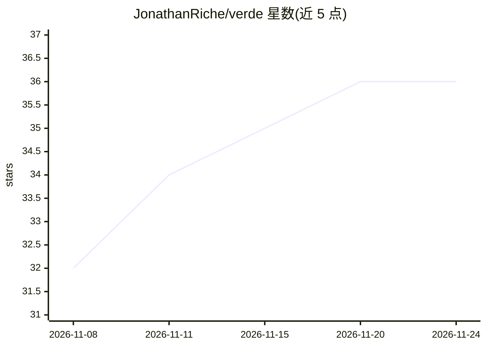

# JonathanRiche/verde

⭐ 36 · Zig · MIT · 推送 2026-11-23 · [GitHub](https://github.com/JonathanRiche/verde) · [官网](https://verdeai.dev) · 个人维护

**在桌面平铺窗口中并排运行各编码 agent 的本地工作区**

用 Zig 编写的原生桌面平铺工作区（非 Electron），用于并排运行 Codex、Claude Code、Cursor、OpenCode、Grok Build、Amp 等编码 agent：GUI 聊天或终端 TUI 两种形态，附带原生浏览器面板（Design Mode 点选元素发送视觉上下文）、Ghostty 终端、变更面板与会话守护进程（关闭窗口后 agent 轮次继续运行）。不内置模型、不代理提示词，驱动本机已登录的各 provider CLI；提供 Linux/macOS/Windows 安装包、CLI 脚本控制、MCP 桥与 iOS/Android 伴侣应用（beta）。

## 筛选速览

| 维度 | 判定 | 备注 |
|---|---|---|
| AI 角色 | `ai-ecosystem` | LLM/agent 周边工具 |
| 许可风险 | `permissive` | MIT |
| 部署形态 | `desktop` | 安装包/桌面程序 |
| 模型依赖 | locked-api |  |
| 硬件要求 | — | 无带数字的原话,不猜 |
| 安装摩擦 | `low` | 无编译、无系统依赖或容器化 |
| 成熟度 | — | 结构信号不足 |

## 能力要点

- 8 种编码 agent 以 GUI 聊天或 TUI 形式并排运行，复用已有订阅与本地 CLI
- Zig 原生 GPU UI 框架构建，非 Electron，本地运行无托管中继
- 无头会话守护进程：关窗后轮次继续运行，跨重启与升级持久化
- verde live 本地 IPC 与 MCP 桥支持脚本化控制（开面板、发提示、中途转向）

## 适用场景

- 在同一平铺窗口中让多个编码 agent 各自处理同一仓库的不同任务
- 审批命令、中途转向运行中的 agent 轮次并查看各 agent 的文件变更
- 在浏览器面板预览 dev server 并点选元素把视觉上下文发给 agent

## 场景标签

`编码 Agent` · 领域:编码与开发

## 证据(README 行号)

> L49: - **Uses the plans you already have.** Verde drives the provider CLIs on your machine. It does not host models or p
> L86: |Agent|GUI chat|Terminal TUI|How Verde talks to it|

## 星数曲线

2026-11-08 32 → 2026-11-24 36（+4）

---
*卡片 v1 · prompt 1.4 · 生成 2026-11-18 · 置信度 high · 依据 README sha `6e7088d65751` · [字段定义](../../DATASET.md)*
