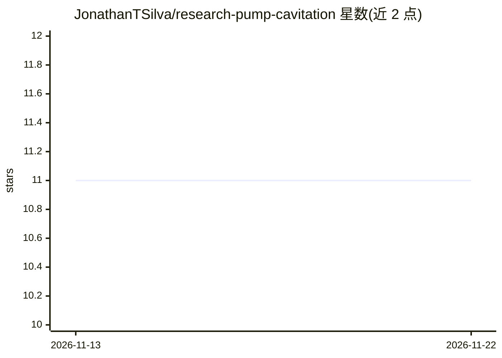

# JonathanTSilva/research-pump-cavitation

⭐ 11 · MATLAB · MIT · 推送 2026-11-17 · [GitHub](https://github.com/JonathanTSilva/research-pump-cavitation) · 个人维护

**基于电机电流分析的液压泵故障诊断研究项目**

巴西 IFSP 电气工程科研启动项目：在实验台上采集液压泵正常运行、气蚀与空转三种工况的电机电流数据，从网络数据包解码电流后提取 18 个数值属性（统计量、熵、峭度、RMS、偏度及 FFT 前 10 谐波幅值），用经贝叶斯优化调参的 RBF 核 SVM 分类，5 折交叉验证。气蚀识别准确率约 94.9%-97.3%，空转 99.6%-100%。代码为 MATLAB 脚本，需 Statistics and Machine Learning Toolbox 与 Wavelet Toolbox；脚本保留研究时原状，运行前需调整数据路径。

## 筛选速览

| 维度 | 判定 | 备注 |
|---|---|---|
| AI 角色 | `ai-native` | 本体是模型或模型工具 |
| 许可风险 | `permissive` | MIT |
| 部署形态 | `None` |  |
| 模型依赖 | — | README 未给出锁定关系 |
| 硬件要求 | — | 无带数字的原话,不猜 |
| 安装摩擦 | `low` | 无编译、无系统依赖或容器化 |
| 成熟度 | — | 结构信号不足 |

## 能力要点

- 从电机启动器与 PLC 数据包中解码电机最大电流
- 每样本提取 18 个属性（时域统计、熵、峭度、FFT 谐波）
- 贝叶斯优化调参的 RBF 核 SVM，5 折交叉验证评估
- 附带原始数据集（每工况约 59,000-61,000 数据包）

## 适用场景

- 复现泵气蚀/空转故障的电流信号分类实验
- 学习工业设备状态监测的特征提取流程
- 研究属性数量对分类准确率的影响

## 场景标签

`科研工具` · 领域:学习与行业

## 证据(README 行号)

> L9: **Diagnose a hydraulic pump from the electric current of its motor.** Cavitation and dry running leave a signature i
> L22: - **An SVM with tuned hyperparameters.** An RBF-kernel SVM, with the box constraint and kernel scale chosen by Baye
> L42: The code is a set of MATLAB scripts. It needs MATLAB with the Statistics and Machine Learning Toolbox and the Wavel

## 星数曲线

2026-11-13 11 → 2026-11-22 11（+0）

---
*卡片 v1 · prompt 1.4 · 生成 2026-11-19 · 置信度 high · 依据 README sha `a6dae950d4ba` · [字段定义](../../DATASET.md)*
