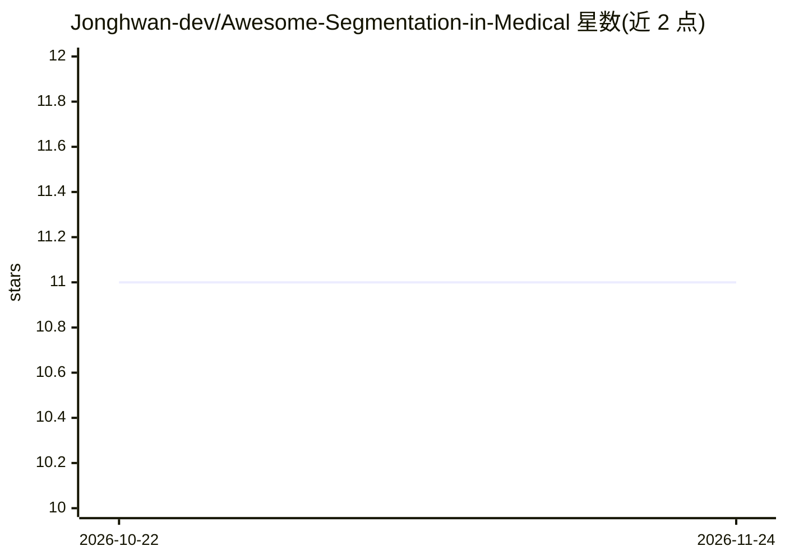

# Jonghwan-dev/Awesome-Segmentation-in-Medical

⭐ 11 · Python · MIT · 推送 2026-01-23 · [GitHub](https://github.com/Jonghwan-dev/Awesome-Segmentation-in-Medical) · 个人维护

**乳腺超声图像分割的公平评测基准框架：11 模型×5 数据集**

面向乳腺超声（BUS）图像分割的深度学习基准框架，收录 11 个分割模型（UNet、UNet++、TransUnet、SwinUnet、CMU-Net、U-KAN 等）与 5 个公开数据集（BUSI、BUSBRA、BUS-UC、BUS-UCLM、Yap2018），并纳入 normal 类别。核心机制是先一次性划分独立测试集再做分层五折交叉验证，最终指标为 5 个模型在测试集上的均值±标准差，防止测试集泄漏与不一致评测。通过 shell 脚本与 YAML 配置驱动训练、测试与结果汇总，支持按说明添加新模型与数据集。

## 筛选速览

| 维度 | 判定 | 备注 |
|---|---|---|
| AI 角色 | `ai-native` | 本体是模型或模型工具 |
| 许可风险 | `permissive` | MIT |
| 部署形态 | `None` |  |
| 模型依赖 | — | README 未给出锁定关系 |
| 硬件要求 | — | 无带数字的原话,不猜 |
| 安装摩擦 | `low` | 无编译、无系统依赖或容器化 |
| 成熟度 | — | 结构信号不足 |

## 能力要点

- 一次性划分独立测试集 + 分层五折交叉验证，防止数据泄漏
- 收录 11 个 CNN/Transformer 分割模型与 5 个公开 BUS 数据集
- shell 脚本 + YAML 配置自动化 k-fold 训练、测试与指标汇总
- 报告 Dice/IoU/HD95/GFLOPs/参数量的均值±标准差结果

## 适用场景

- 在统一的划分与指标下复现评测乳腺超声分割模型
- 把自己的新分割模型加入框架与已有模型做同条件对比
- 整理论文所需的 k-fold 交叉验证结果表格

## 场景标签

`模型评测` `目标检测` · 领域:评测与运维

## 证据(README 行号)

> L3: A robust and reproducible framework for benchmarking deep learning models on Breast Ultrasound (BUS) image segmentat
> L33: * **⚙️ Automated & Configurable Pipelines:** Comes with powerful shell scripts (run\_cnn.sh, run\_vit.sh) that auto

## 星数曲线

2026-10-22 11 → 2026-11-24 11（+0）

---
*卡片 v1 · prompt 1.4 · 生成 2026-11-19 · 置信度 high · 依据 README sha `7a15aa2ad6d9` · [字段定义](../../DATASET.md)*
