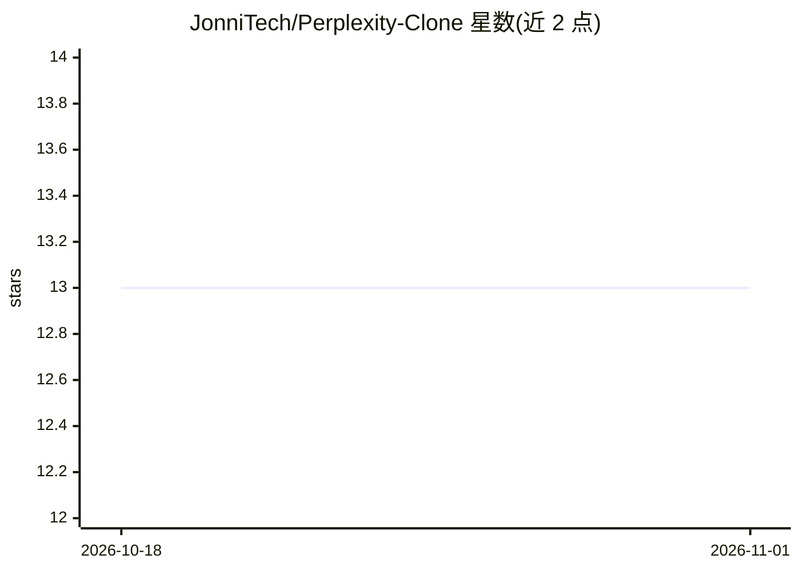

# JonniTech/Perplexity-Clone

⭐ 13 · TypeScript · 推送 2026-01-30 · [GitHub](https://github.com/JonniTech/Perplexity-Clone) · [官网](https://perplexityclone-zeta.vercel.app) · 个人维护 · 中文 README

**复刻 Perplexity 界面的 Web 搜索问答应用（RAG）**

用 React 19、TypeScript、Tailwind CSS 与 Vite 构建的 Perplexity AI 搜索界面复刻应用：用户提问后经 SerpAPI 检索网页结果，提取上下文交给 GLM-4.7-Flash 生成流式回答，并附带来源引用展示。功能包括 Markdown 与代码高亮渲染、Zustand 管理并本地持久化聊天历史、Clerk 登录认证与路由保护。README 同时声明该项目用作作者求职的作品展示。需配置 Clerk、Z.ai（GLM）与 SerpAPI 三组 API key 后本地运行。

## 筛选速览

| 维度 | 判定 | 备注 |
|---|---|---|
| AI 角色 | `ai-native` | 本体是模型或模型工具 |
| 许可风险 | `none` | — |
| 部署形态 | `library` | 以包/库形式分发 |
| 模型依赖 | — | README 未给出锁定关系 |
| 硬件要求 | — | 无带数字的原话,不猜 |
| 安装摩擦 | `low` | 无编译、无系统依赖或容器化 |
| 成熟度 | — | 结构信号不足 |

## 能力要点

- SerpAPI 检索 + GLM-4.7-Flash 生成的实时 RAG 流水线
- 流式回答与来源引用轮播展示
- Zustand 状态管理，聊天历史本地持久化
- Clerk 认证与会话管理

## 适用场景

- 获得带实时网页来源引用的搜索问答
- 学习客户端 RAG 流水线与 React 状态管理的实现方式
- 作为 Senior 前端工程师求职的作品展示项目

## 场景标签

`RAG` · 领域:知识与检索

## 证据(README 行号)

> L15: **Perplexity Clone** is a high-fidelity reconstruction of the Perplexity AI search interface, engineered to demonst
> L23: * **Workflow**: User Query -> **SerpAPI** (Google Search) -> Context Extraction -> **LLM** (GLM-4.7-Flash) -> Strea

## 星数曲线

2026-10-18 13 → 2026-11-01 13（+0）

---
*卡片 v1 · prompt 1.4 · 生成 2026-11-01 · 置信度 high · 依据 README sha `ecba74354549` · [字段定义](../../DATASET.md)*
