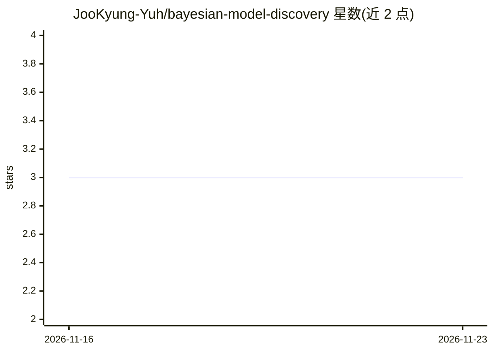

# JooKyung-Yuh/bayesian-model-discovery

⭐ 3 · Python · MIT · 推送 2026-11-04 · [GitHub](https://github.com/JooKyung-Yuh/bayesian-model-discovery) · [官网](https://arxiv.org/abs/2610.25747) · 组织维护

**为科研人员提供 LLM 提议+贝叶斯拟合的模型发现闭环代码**

论文《Bayesian Model Discovery with Language Models》的配套研究代码：语言模型从信念包（已有观测、表达式、证据、参数摘要、预测误差）提议候选函数形式，引擎用 PyMC 的序贯蒙特卡洛拟合每个候选，按证据保留至多十二个模型族，以贝叶斯模型平均预测，并用联合期望信息增益选择下一个实验，形成闭环。面向科学研究与复现场景，内置五个基准 runner 与五个带输出的示例 notebook。README 声明为研究代码，接口与文件格式可在无弃用期的情况下变更。

## 筛选速览

| 维度 | 判定 | 备注 |
|---|---|---|
| AI 角色 | `ai-native` | 本体是模型或模型工具 |
| 许可风险 | `permissive` | MIT |
| 部署形态 | `library` | 以包/库形式分发 |
| 模型依赖 | — | README 未给出锁定关系 |
| 硬件要求 | — | 无带数字的原话,不猜 |
| 安装摩擦 | `low` | 无编译、无系统依赖或容器化 |
| 成熟度 | `idea` | |

## 能力要点

- LLM 提议候选模型 + SMC 拟合 + 贝叶斯模型平均 + 联合 EIG 实验设计的完整闭环
- 提供 mock proposer，无需 API key 即可运行三回合完整流程
- 内置 SynthCount、ChemBench、BoxingGym、NeuronBench、ForceBench 等基准 runner
- 五个示例 notebook 连同输出一并提交，可不运行直接阅读

## 适用场景

- 复现论文中的贝叶斯模型发现基准实验
- 在无需 API key 的 mock 模式下理解算法各步骤
- 把该闭环流程应用于剂量响应、化学反应速率等函数形式发现问题

## 场景标签

`科研工具` · 领域:学习与行业

## 证据(README 行号)

> L3: **Find the functional form of an unknown system: a language model proposes candidate models, a Bayesian
> L12: A language model proposes model families (functional forms with an observation distribution) from a
> L17: next experiment maximizes the joint expected information gain (EIG) about which family generated the

## 星数曲线

2026-11-16 3 → 2026-11-23 3（+0）

---
*卡片 v1 · prompt 1.4 · 生成 2026-11-22 · 置信度 high · 依据 README sha `93135d0a6041` · [字段定义](../../DATASET.md)*
