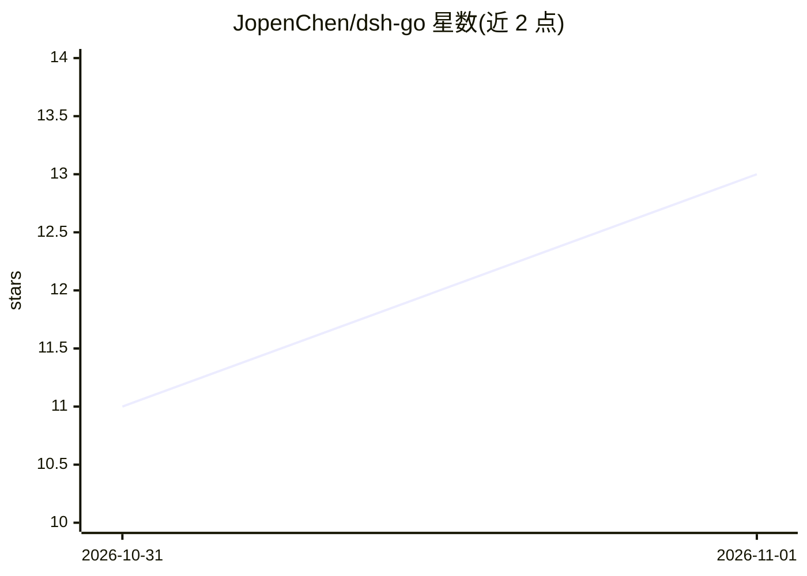

# JopenChen/dsh-go

⭐ 13 · Go · MIT · 推送 2026-09-12 · [GitHub](https://github.com/JopenChen/dsh-go) · 个人维护 · 中文 README

**纯 Go 进程内 DeepSeek Harness Agent 参考实现，供阅读复刻内核**

把官方 DeepSeek Harness（DSH）的 Turn/Step 双循环、事件溯源、Goal 规划、工具治理等能力接缝逐词对译为 Go 代码，以可嵌入库与示例形式提供。定位为参考实现与学习素材，明确声明非生产级框架、非 LangChain/Eino 替代品。含 9 个零依赖示例、328 条测试用例矩阵与中英双语文档站；持久化支持 JSONL 与 SQLite（纯 Go 无 CGO），LLM 层内建 DeepSeek Provider（流式 SSE、连接池、稳定失败分类）。

## 筛选速览

| 维度 | 判定 | 备注 |
|---|---|---|
| AI 角色 | `ai-ecosystem` | LLM/agent 周边工具 |
| 许可风险 | `permissive` | MIT |
| 部署形态 | `None` |  |
| 模型依赖 | locked-api |  |
| 硬件要求 | — | 无带数字的原话,不猜 |
| 安装摩擦 | `low` | 无编译、无系统依赖或容器化 |
| 成熟度 | `idea` | |

## 能力要点

- 事件溯源会话（45+ 事件词汇表）+ fold 派生投影 + Goal 状态机
- 四段工具流水线 pre→execute→post→result，含 30+ 能力包（文件/shell/子代理/MCP 等）
- DeepSeek Provider：流式 SSE、连接池、与官方 error.ts 对齐的失败分类
- 9 个可运行示例（tutorial 为入门）与 328 条测试用例矩阵

## 适用场景

- 对照源码阅读、调试一个真实 Agent 的内核运作
- 按事件溯源→fold 投影→Goal 状态机三步学习 Agent 内核
- 在 Go 后端中以内嵌库方式实验 DSH 能力接缝
- 作为并发加固与连接池调优的工程范本研读

## 场景标签

`Agent 框架` `教程课程` · 领域:Agent 开发

## 证据(README 行号)

> L15: > **Dsh-Go** 是一份纯 Go、**进程内**的 DeepSeek Harness Agent **参考实现**——它把官方 DSH 的 Turn/Step 双循环、事件溯源、Goal 规划、工具治理等核心能力接缝，逐词
> L17: > 它定位为**参考实现与学习素材**，而非与 LangChain / Eino / 官方 DSH 竞争的生产级框架：生态、背书与多模型适配均非本文目标，本文目标是"**读懂 Agent 内核**"。

## 星数曲线

2026-10-31 11 → 2026-11-01 13（+2）

---
*卡片 v1 · prompt 1.4 · 生成 2026-10-31 · 置信度 high · 依据 README sha `fa7fd0fc6d6e` · [字段定义](../../DATASET.md)*
