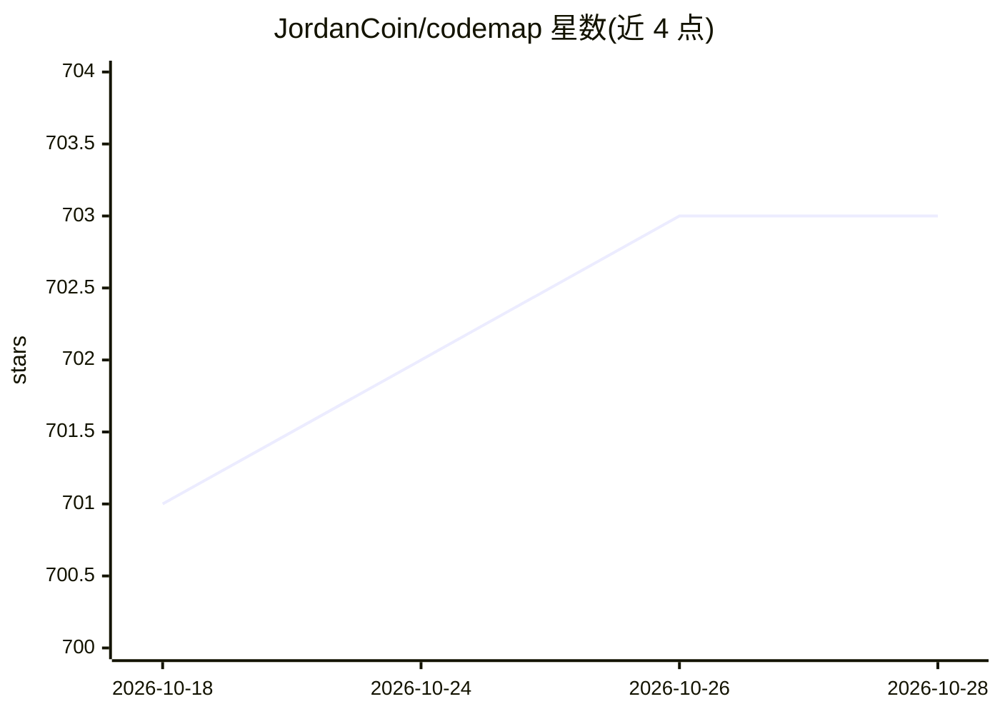

# JordanCoin/codemap

⭐ 704 · Go · MIT · 推送 2026-10-12 · [GitHub](https://github.com/JordanCoin/codemap) · 个人维护

**给编码 agent 提供仓库结构与依赖图谱的 CLI/MCP 上下文工具**

Go 编写的单个静态二进制 CLI，为 Claude Code、Codex 等编码代理提供仓库结构图、依赖解析与影响面（blast radius）分析：通过各生态自身规则（go.mod、cargo metadata、package.json exports 等）解析 import，标注每个依赖回答的覆盖率状态（complete/partial/unavailable）。以 hooks、stdio MCP 服务器（19 个工具）与 CLI 三种方式接入代理。安装支持 Homebrew、scoop、go install 与源码构建；--deps 功能依赖 ast-grep，发布 tarball 不含该可执行文件，需单独安装或用 codemap-full 产物。

## 筛选速览

| 维度 | 判定 | 备注 |
|---|---|---|
| AI 角色 | `ai-ecosystem` | LLM/agent 周边工具 |
| 许可风险 | `permissive` | MIT |
| 部署形态 | `library` | 以包/库形式分发 |
| 模型依赖 | — | README 未给出锁定关系 |
| 硬件要求 | — | 无带数字的原话,不猜 |
| 安装摩擦 | `low` | 无编译、无系统依赖或容器化 |
| 成熟度 | — | 结构信号不足 |

## 能力要点

- 按各语言生态真实规则解析依赖，支持 21 种 ast-grep 语言规则
- 每个依赖回答携带覆盖率状态，区分'无导入'与'无法判断'
- stdio MCP 服务器提供 19 个工具，5 个核心工具带 OutputSchema 返回结构化内容
- 可分析远程 GitHub/GitLab 仓库，shallow-clone 到临时目录

## 适用场景

- 让编码代理在会话开始即获得仓库结构与热点文件信息
- 修改文件前查询谁依赖它，评估影响面
- 在大型多语言仓库中用自然语言查找实现某功能的代码位置

## 场景标签

 · 领域:开发者工具/代码分析

## 证据(README 行号)

> L17: cd your-repo && codemap setup                      # hooks + MCP for Claude Code and Codex
> L109: `codemap setup` configures Claude Code and Codex by default:

## 星数曲线

2026-10-18 701 → 2026-10-28 703（+2）

---
*卡片 v1 · prompt 1.4 · 生成 2026-10-22 · 置信度 high · 依据 README sha `433940b78408` · [字段定义](../../DATASET.md)*
