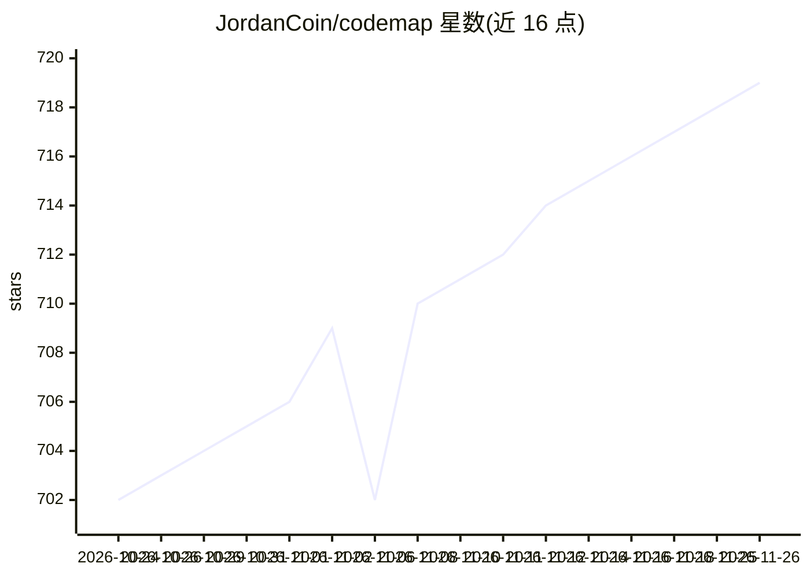

# JordanCoin/codemap

⭐ 719 · Go · MIT · 推送 2026-11-21 · [GitHub](https://github.com/JordanCoin/codemap) · 个人维护

**为编码 agent 提供代码库结构上下文的 CLI 工具**

codemap 是面向 coding agent 的代码库结构信息工具：解析各生态的真实导入规则生成依赖图，提供结构总览（orientation）、反向依赖查询（importers）与修改影响范围（blast radius），每个依赖答案附带 complete/partial/unavailable 覆盖状态以区分

## 筛选速览

| 维度 | 判定 | 备注 |
|---|---|---|
| AI 角色 | `ai-ecosystem` | LLM/agent 周边工具 |
| 许可风险 | `permissive` | MIT |
| 部署形态 | `None` |  |
| 模型依赖 | — | README 未给出锁定关系 |
| 硬件要求 | — | 无带数字的原话,不猜 |
| 安装摩擦 | `low` | 无编译、无系统依赖或容器化 |
| 成熟度 | — | 结构信号不足 |

## 能力要点

- 通过各生态真实导入规则（go.mod、package.json exports、tsconfig paths）解析依赖，非字符串匹配
- MCP 服务器模式提供 19 个 stdio 工具，hooks 在会话开始与编辑前后自动注入上下文
- 每个依赖答案报告覆盖状态，partial 图不会伪装成 complete
- brew/scoop 单静态二进制分发

## 适用场景

- 让 agent 在会话开始快速了解陌生代码库结构
- 修改文件前查询哪些文件依赖它
- 在 CI 中生成依赖分析

## 场景标签

`编码 Agent` · 领域:编码与开发

## 证据(README 行号)

> L3: > **codemap — structural ground truth for coding agents.**
> L90: ## Agent integration
> L93: - **MCP**: `codemap mcp` serves 19 tools over stdio. docs/MCP.md

## 星数曲线

2026-10-24 702 → 2026-11-26 719（+17）

---
*卡片 v1 · prompt 1.4 · 生成 2026-11-24 · 置信度 high · 依据 README sha `1f8ef393bdf9` · [字段定义](../../DATASET.md)*
