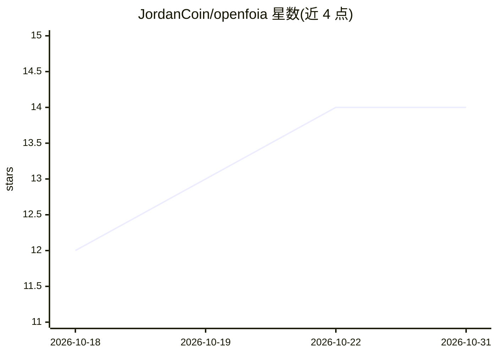

# JordanCoin/openfoia

⭐ 14 · Python · NOASSERTION · 推送 2026-10-26 · [GitHub](https://github.com/JordanCoin/openfoia) · 个人维护

**本地优先的 FOIA 调查工具包：文档提取、实体抽取与请求跟踪**

面向记者、研究者与公民的本地化政府信息公开（FOIA）调查工具：内置 PDF 文本提取引擎（损坏字体与无编码 PDF 的多级解析，必要时转 Tesseract OCR），四级实体抽取（LLM→GLiNER→spaCy→regex 逐级回退，可完全不用模型），实体关系图与带引注的发现记录。覆盖联邦 FOIA 及 50 州与 DC 的法规、时限与上诉路径，支持向 53 个联邦机构发起请求。数据经 SQLCipher 加密存储，提供便携模式、Tor 服务与 3 遍覆写的取证清除；默认全部离线运行，数据不出本机。

## 筛选速览

| 维度 | 判定 | 备注 |
|---|---|---|
| AI 角色 | `ai-native` | 本体是模型或模型工具 |
| 许可风险 | `none` | NOASSERTION |
| 部署形态 | `None` |  |
| 模型依赖 | locked-api |  |
| 硬件要求 | — | 无带数字的原话,不猜 |
| 安装摩擦 | `low` | 无编译、无系统依赖或容器化 |
| 成熟度 | — | 结构信号不足 |

## 能力要点

- 四级实体抽取链（LLM/GLiNER/spaCy/regex），regex 层无需模型
- 联邦及 50 州+DC 公共记录法的时限、费用与上诉路径库
- SQLCipher AES-256 加密、便携 USB 模式与取证级清除
- 跨源检索 MuckRock/DocumentCloud/SEC EDGAR/OpenSanctions 等 13 个数据源

## 适用场景

- 记者本地检索、阅读并引用政府文件开展调查
- 向对应辖区机关起草、提交并跟踪信息公开请求时限
- 从文档中抽取实体与关系并生成带引注的报告
- 在高风险环境用 U 盘便携模式或 Tails 离线工作并安全清除痕迹

## 场景标签

`OCR` `文档解析` `知识图谱` · 领域:知识与检索

## 证据(README 行号)

> L3: **Local-first investigation toolkit for journalists, researchers, and citizens.**
> L7: *One real government document, 45 entities, 166 relationships, extracted locally in seconds. No cloud. No API keys.*
> L53: |**Entity extraction**|Four tiers, LLM, GLiNER, spaCy, regex, each falling back to the next. Regex always works, wi

## 星数曲线

2026-10-18 12 → 2026-10-31 14（+2）

---
*卡片 v1 · prompt 1.4 · 生成 2026-10-31 · 置信度 high · 依据 README sha `d49a745946a4` · [字段定义](../../DATASET.md)*
