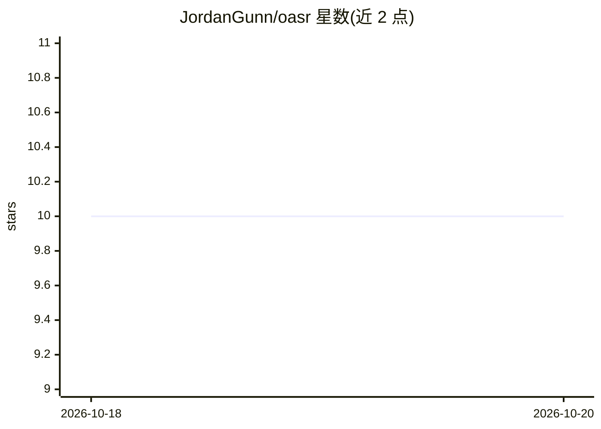

# JordanGunn/oasr

⭐ 10 · Python · NOASSERTION · 推送 2026-02-06 · [GitHub](https://github.com/JordanGunn/oasr) · 个人维护

**跨 IDE 的 AI agent 技能注册与同步 CLI，一处注册多处分发**

面向使用 AI 编码助手的开发者的命令行工具：将本地文件夹或 GitHub/GitLab URL 中的 agent 技能注册到统一注册表，避免在多个 IDE 间手工复制造成版本漂移（skill drift）；通过 `oasr adapter` 为 Cursor、Windsurf、Codex、GitHub Copilot、Claude Code 五种 IDE 生成对应格式的适配文件，`oasr sync` 检测来源变更，`oasr exec` 配合策略配置执行技能。另提供动态 Shell 补全（Bash/Zsh/Fish/PowerShell）与 JSON 输出模式。README 引用 docs 中的 Quickstart 文档，未直接给出安装命令。

## 筛选速览

| 维度 | 判定 | 备注 |
|---|---|---|
| AI 角色 | `ai-ecosystem` | LLM/agent 周边工具 |
| 许可风险 | `none` | NOASSERTION |
| 部署形态 | `None` |  |
| 模型依赖 | — | README 未给出锁定关系 |
| 硬件要求 | — | 无带数字的原话,不猜 |
| 安装摩擦 | `low` | 无编译、无系统依赖或容器化 |
| 成熟度 | — | 结构信号不足 |

## 能力要点

- 单一注册表同步本地与 GitHub/GitLab 远程技能来源
- 为 Cursor/Windsurf/Codex/Copilot/Claude Code 生成 IDE 适配器
- `oasr exec` 按策略配置安全执行技能
- 支持 Bash/Zsh/Fish/PowerShell 动态补全与 `--json v2` 结构化输出

## 适用场景

- 我在多个 AI 编码工具间复用同一套技能，不想手工复制
- 追踪技能在不同 IDE 间的版本漂移并自动同步
- 直接从 GitHub/GitLab 仓库引用团队共享的技能

## 场景标签

 · 领域:开发者工具/agent 技能生态

## 证据(README 行号)

> L3: **Open Agent Skill Registry** — Register, sync, and reuse AI agent skills across IDEs with a single source of truth.
> L22: ASR keeps your skills in a registry, syncs local and remote sources, and generates thin adapters for each IDE.

## 星数曲线

2026-10-18 10 → 2026-10-20 10（+0）

---
*卡片 v1 · prompt 1.4 · 生成 2026-10-18 · 置信度 high · 依据 README sha `dde25384657c` · [字段定义](../../DATASET.md)*
