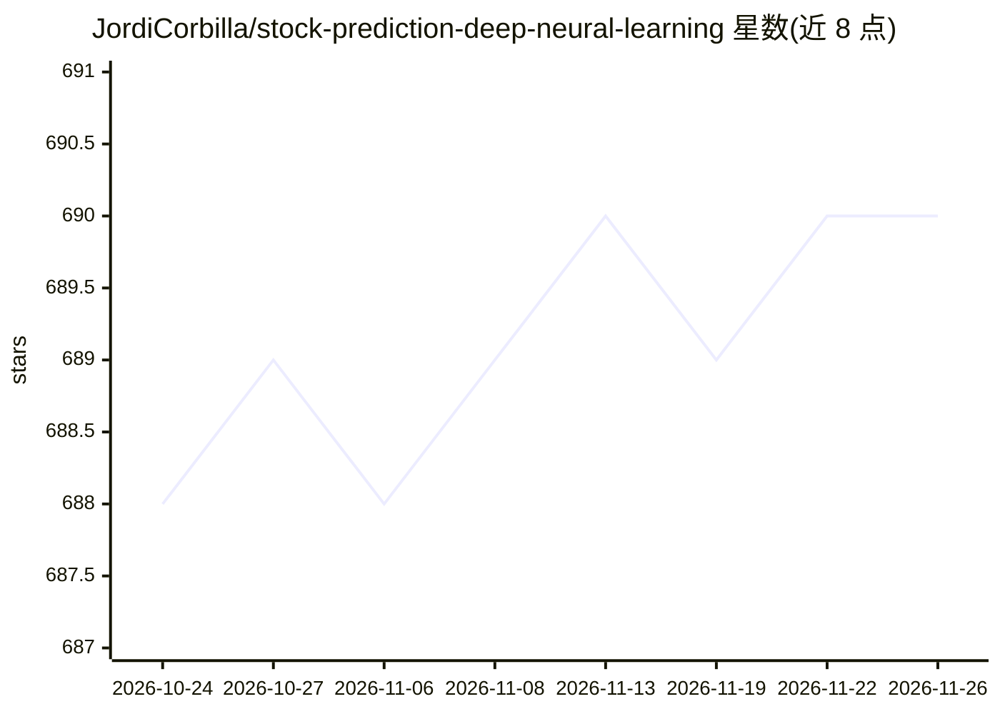

# JordiCorbilla/stock-prediction-deep-neural-learning

⭐ 690 · Python · Apache-2.0 · 推送 2026-11-01 · [GitHub](https://github.com/JordiCorbilla/stock-prediction-deep-neural-learning) · [官网](https://jordicorbilla.github.io/stock-prediction-deep-neural-learning/) · 个人维护

**金融时序 LSTM 预测研究库：可复现训练与基准评测**

起源于 2020 年的 LSTM 股价预测实验，现演化为量化预测研究环境。提供 TensorFlow LSTM 模型（v7 方向+幅度、v8 多任务共享架构、v9 收益模型）、训练/验证/测试分离、扩展窗口走前验证、相对朴素基线的 RMSE skill 评测、带交易成本的方向性策略诊断与多资产 arena HTML 报告。训练接受显式种子并记录运行元数据以支持复现。安装方式为 conda 或 pip，发布 quant-forecast CLI；不构成可部署交易策略。

## 筛选速览

| 维度 | 判定 | 备注 |
|---|---|---|
| AI 角色 | `ai-native` | 本体是模型或模型工具 |
| 许可风险 | `permissive` | Apache-2.0 |
| 部署形态 | `library` | 以包/库形式分发 |
| 模型依赖 | — | README 未给出锁定关系 |
| 硬件要求 | — | 无带数字的原话,不猜 |
| 安装摩擦 | `medium` | 含编译或系统依赖之一 |
| 成熟度 | `idea` | |

## 能力要点

- TensorFlow LSTM 多版本模型：价格/收益/方向+幅度多任务目标
- 相对 last-price 朴素基线的 RMSE skill 与方向准确率评测
- 带交易成本假设的方向性回测诊断与 arena HTML 报告
- 显式种子、确定性操作与 SHA-256 数据快照的复现机制

## 适用场景

- 训练并评测股票/指数时序预测模型
- 将多组样本外预测与朴素基线做统一基准比较
- 金融时序研究中的走前验证与不确定性区间实验

## 场景标签

`金融量化` `模型评测` · 领域:评测与运维

## 证据(README 行号)

> L3: **Reproducible deep-learning research for financial time-series forecasting.**
> L19: - TensorFlow LSTM models for price, return, delta and trend-residual targets.
> L25: - Directional accuracy.

## 星数曲线

2026-10-24 688 → 2026-11-26 690（+2）

---
*卡片 v1 · prompt 1.4 · 生成 2026-11-24 · 置信度 high · 依据 README sha `3e84cfd07e6f` · [字段定义](../../DATASET.md)*
