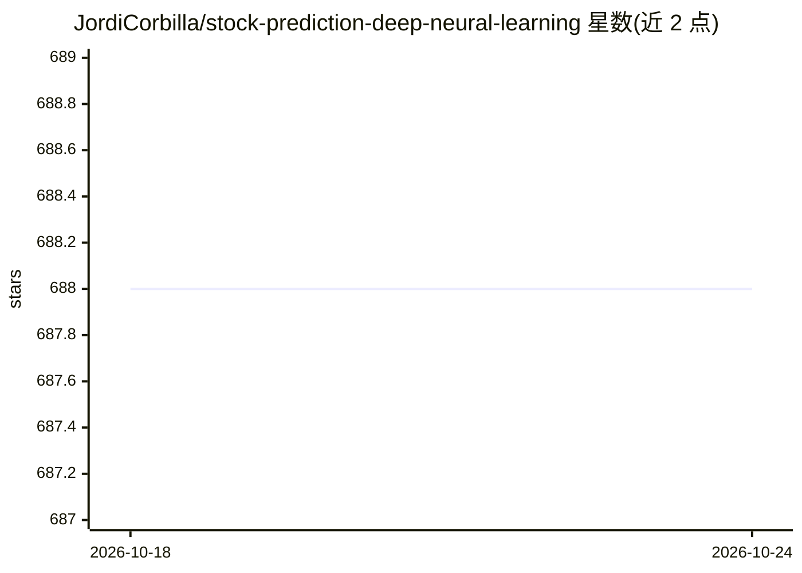

# JordiCorbilla/stock-prediction-deep-neural-learning

⭐ 688 · Python · Apache-2.0 · 推送 2026-10-10 · [GitHub](https://github.com/JordiCorbilla/stock-prediction-deep-neural-learning) · [官网](https://jordicorbilla.github.io/stock-prediction-deep-neural-learning/) · 个人维护

**给量化研究者的 TensorFlow LSTM 股价预测与评测实验环境**

从 2020 年的 LSTM 股价预测实验演进为量化预测研究库：用 TensorFlow LSTM 训练价格/收益率/趋势残差/方向+幅度（v7、v8 多任务）等目标模型，保留历史 CLI 入口兼容。维护的 quant_forecast_lab 包提供训练/验证/测试分离、扩展窗口切分、RMSE skill 相对朴素基准评测、方向性策略回测诊断（含交易成本）、conformal 残差带与种子/元数据记录，以及 quant-forecast CLI 与多资产 Arena HTML 报告。README 明确声明结果不构成策略可部署证据。

## 筛选速览

| 维度 | 判定 | 备注 |
|---|---|---|
| AI 角色 | `ai-native` | 本体是模型或模型工具 |
| 许可风险 | `permissive` | Apache-2.0 |
| 部署形态 | `library` | 以包/库形式分发 |
| 模型依赖 | — | README 未给出锁定关系 |
| 硬件要求 | — | 无带数字的原话,不猜 |
| 安装摩擦 | `medium` | 含编译或系统依赖之一 |
| 成熟度 | — | 结构信号不足 |

## 能力要点

- TensorFlow LSTM 多版本模型（v7 方向+幅度递归推理，v8 共享多任务架构）
- RMSE skill 相对 last-price 朴素基准的评测层与方向准确率
- 交易成本感知的方向性策略诊断（年化收益/波动、Sharpe、最大回撤）
- 扩展窗口 walk-forward 切分与种子、数据 SHA-256、运行时元数据记录

## 适用场景

- 训练并评测 LSTM 股价/收益率预测模型
- 对已保存的样本外预测做 RMSE skill 与策略指标基准评测
- 复现历史实验并对预测不确定性做 conformal 区间实验

## 场景标签

`金融量化` `模型评测` · 领域:评测与运维

## 证据(README 行号)

> L3: **Reproducible deep-learning research for financial time-series forecasting.**
> L16: - TensorFlow LSTM models for price, return, delta and trend-residual targets.
> L327: This project is a forecasting research environment. Results from one asset, period or validation split should not 

## 星数曲线

2026-10-18 688 → 2026-10-24 688（+0）

---
*卡片 v1 · prompt 1.4 · 生成 2026-10-21 · 置信度 high · 依据 README sha `1e2949069121` · [字段定义](../../DATASET.md)*
