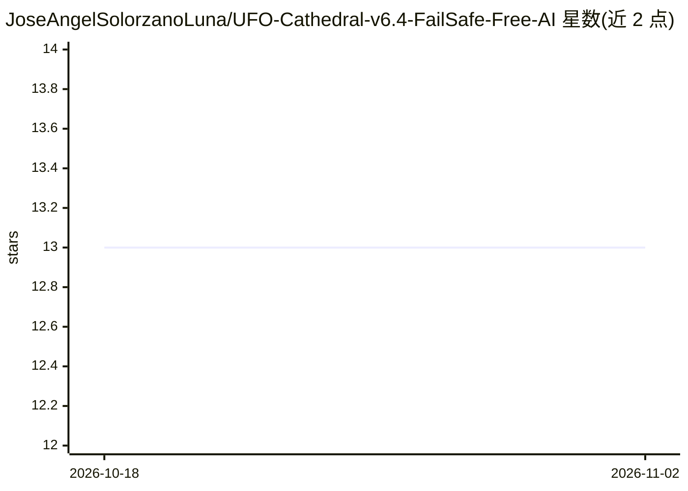

# JoseAngelSolorzanoLuna/UFO-Cathedral-v6.4-FailSafe-Free-AI

⭐ 13 · HTML · MIT · 推送 2026-09-14 · [GitHub](https://github.com/JoseAngelSolorzanoLuna/UFO-Cathedral-v6.4-FailSafe-Free-AI) · [官网](https://joseangelsolorzanoluna.github.io/UFO-Cathedral-v6.4-FailSafe-Free-AI/) · 个人维护 · 中文 README

**8GB 内存离线 computer-use AI 代理，含许可门与账本安全机制**

本地运行的个人 AI 伴侣/computer-use 项目：通过视觉识别与点击、输入操作电脑，管道为 BoundedSensorGate → Council → Merkle Permit → Ledger → AEGIS，动作需 3 次连续安全重放才标记 TRUTH，账本用 SHA256 哈希链记录并可由 verify_ledger.py 校验。模型经 Ollama 拉取（phi3:mini/llama3.2:3b 等 5 个 opcode family），配 Whisper STT 与 Piper/XTTS 语音。分 Lite/Standard/Full 三档内存路径，明确声明不做云端、不宣称 iPhone 跑 5 模型。另含大量 doctrine 类条目与交易限额卡等衍生内容。

## 筛选速览

| 维度 | 判定 | 备注 |
|---|---|---|
| AI 角色 | `ai-native` | 本体是模型或模型工具 |
| 许可风险 | `permissive` | MIT |
| 部署形态 | `None` |  |
| 模型依赖 | local-ok | 支持本地模型 |
| 硬件要求 | — | 无带数字的原话,不猜 |
| 安装摩擦 | `low` | 无编译、无系统依赖或容器化 |
| 成熟度 | — | 结构信号不足 |

## 能力要点

- Shadow Mode：动作须 3 次安全重放后才生效（SAFE/HOLD/ESCALATE）
- SHA256 哈希链账本与 verify_ledger.py 校验脚本
- Lite/Standard/Full 三档内存路径，最低 1.8GB phi3:mini
- Ollama + Whisper STT + Piper/XTTS 全离线语音与对话

## 适用场景

- 在 8GB 内存电脑上离线运行带安全审计的 computer-use 助手
- 本地语音伴侣（STT + TTS）配合 Safety Card 状态管理
- 研究带许可门/账本机制的 agent 安全设计

## 场景标签

`GUI 自动化` `语音识别` `语音合成` · 领域:效率与自动化

## 证据(README 行号)

> L14: 100% free. Offline. ~8GB. Vision + click + type. Safer alternative to paid Operator / computer-use tools. **No clou
> L37: - **5 Geometric Models as Opcode Families:** Phi3 sphere, Llama pyramid, Llama graph, Qwen torus, Llava eye
> L57: ollama pull phi3:mini

## 星数曲线

2026-10-18 13 → 2026-11-02 13（+0）

---
*卡片 v1 · prompt 1.4 · 生成 2026-10-31 · 置信度 mid · 依据 README sha `6ba04f36de32` · [字段定义](../../DATASET.md)*
