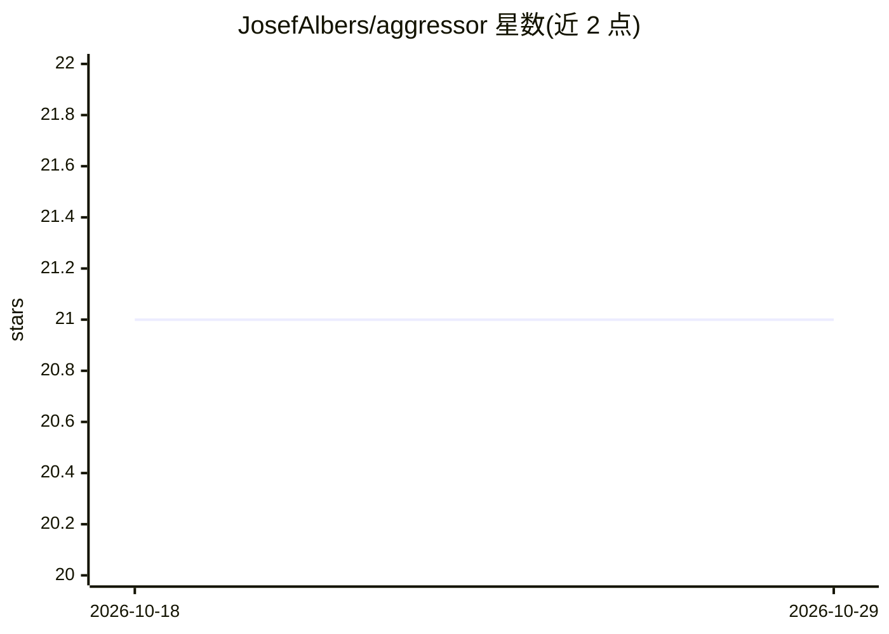

# JosefAlbers/aggressor

⭐ 21 · Python · Apache-2.0 · 推送 2026-07-20 · [GitHub](https://github.com/JosefAlbers/aggressor) · 个人维护

**单文件自回归扩散模型：图像与语音生成的极简实现**

基于 MLX 从零实现的超小自回归扩散模型，不使用向量量化：一个微型 transformer 负责自回归，一个 MLP 负责带时间嵌入的扩散去噪，调度器处理前向/反向扩散过程。整个模型集中在单个 Python 文件 aggressor.py 中，包含 Aggressor/Transformer/Denoiser/Scheduler 四个组件。运行 python aggressor.py 即可训练，README 称 60000 张图 20 个 epoch 在 8GB M2 MacBook 上约 7~8 分钟。支持 CIFAR、MNIST 图像与音频生成。

## 筛选速览

| 维度 | 判定 | 备注 |
|---|---|---|
| AI 角色 | `ai-native` | 本体是模型或模型工具 |
| 许可风险 | `permissive` | Apache-2.0 |
| 部署形态 | `None` |  |
| 模型依赖 | — | README 未给出锁定关系 |
| 硬件要求 | — | 无带数字的原话,不猜 |
| 安装摩擦 | `low` | 无编译、无系统依赖或容器化 |
| 成熟度 | — | 结构信号不足 |

## 能力要点

- 无向量量化的自回归图像生成最简实现
- 仅依赖基础 MLX 操作，单文件实现
- transformer + MLP 扩散的组合架构
- 可在 8GB 内存 Apple Silicon MacBook 上训练

## 适用场景

- 学习自回归扩散模型的最小实现结构
- 在小规模数据集（CIFAR/MNIST）上实验图像生成
- 在 Apple Silicon 上本地训练生成模型

## 场景标签

`图像生成` `语音合成` · 领域:内容生成

## 证据(README 行号)

> L15: A simplest possible implementation of Autoregressive Image Generation without Vector Quantization.
> L20: - **Minimal Dependencies**: Built from scratch using only basic MLX operations.

## 星数曲线

2026-10-18 21 → 2026-10-29 21（+0）

---
*卡片 v1 · prompt 1.4 · 生成 2026-10-28 · 置信度 high · 依据 README sha `45d33c7628cc` · [字段定义](../../DATASET.md)*
