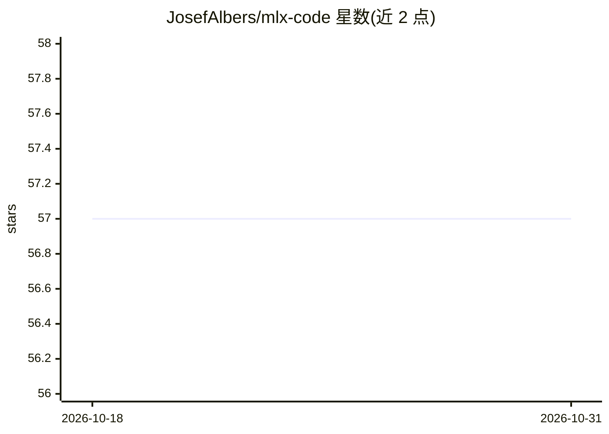

# JosefAlbers/mlx-code

⭐ 57 · Python · Apache-2.0 · 推送 2026-06-22 · [GitHub](https://github.com/JosefAlbers/mlx-code) · [官网](https://mlx-code.com) · 个人维护

**面向 Mac 的本地 MLX 编码 Agent，以 Git 为状态存储**

基于 Apple MLX 的编码 agent，在 Mac 本机运行推理服务器与 TUI harness，无需 API key 与云端。以 Git 作为状态机：文件改动连同完整对话作为 commit 提交到独立 worktree，支持按 hash 恢复会话、从任意检查点分支。提供连续批处理引擎、多协议本地服务器（同时兼容 OpenAI/Anthropic/Gemini/Codex 线格式）与 Python 库形式的多 agent 管道；也可切换 Claude/Gemini/DeepSeek 等远端后端。文件工具强制 worktree 路径沙箱。当前版本 v0.0.27。

## 筛选速览

| 维度 | 判定 | 备注 |
|---|---|---|
| AI 角色 | `ai-native` | 本体是模型或模型工具 |
| 许可风险 | `permissive` | Apache-2.0 |
| 部署形态 | `library` | 以包/库形式分发 |
| 模型依赖 | locked-api |  |
| 硬件要求 | — | 无带数字的原话,不猜 |
| 安装摩擦 | `low` | 无编译、无系统依赖或容器化 |
| 成熟度 | — | 结构信号不足 |

## 能力要点

- Git commit 记录 agent 状态与对话，可按 hash 恢复、任意检查点分支
- 本地 MLX 推理服务器支持连续批处理与 KV prefix cache，多 agent 并发共享 GPU 上下文
- 单一 pip 安装包含推理引擎、多协议 API 服务器、agent 循环、工具与 TUI
- 文件工具强制路径沙箱，agent 在独立 worktree 内编辑

## 适用场景

- 在 Mac 上离线运行编码 agent，数据不出本机
- 按 spec/draft/review/verify 阶段热切换 agent 配置做编码流水线
- 用 Python API 搭建多 agent 并行或委派任务的后台 worker
- 让 claude/codex/gemini 等 CLI 前端连接本地模型

## 场景标签

`编码 Agent` `多智能体` · 领域:Agent 开发

## 证据(README 行号)

> L3: A Git-native coding agent that can run entirely on your Mac. No API keys, no cloud, and no data leaving your machine
> L28: - **Git is the state machine.** Every file-changing agent step is committed with the conversation that produced it,

## 星数曲线

2026-10-18 57 → 2026-10-31 57（+0）

---
*卡片 v1 · prompt 1.4 · 生成 2026-10-24 · 置信度 high · 依据 README sha `cd688b3e1447` · [字段定义](../../DATASET.md)*
