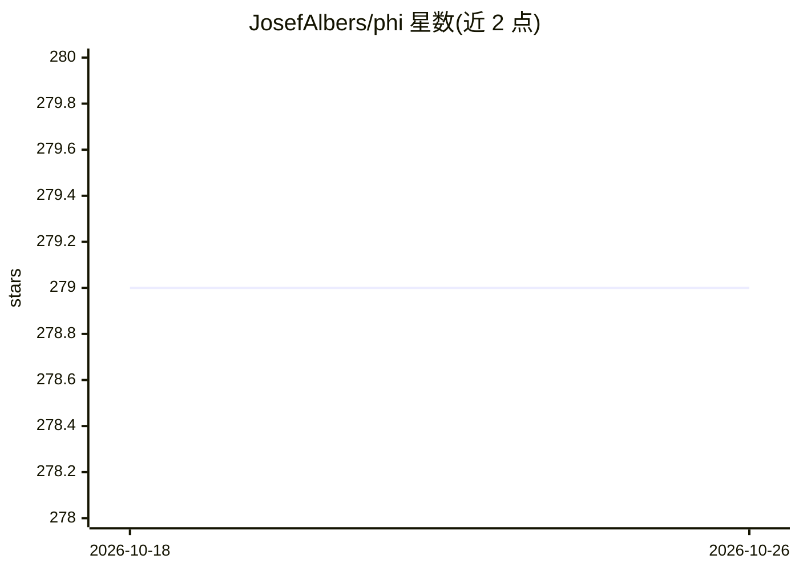

# JosefAlbers/phi

⭐ 279 · Jupyter Notebook · MIT · 推送 2026-07-31 · [GitHub](https://github.com/JosefAlbers/phi) · [官网](https://medium.com/@albersj66) · 个人维护

**在 Apple Silicon 上本地运行 Phi 系列视觉与语言模型的框架**

基于 MLX 框架在 Apple Silicon Mac 上本地运行 Phi-3/3.5/4 系列模型，提供文本生成、视觉问答、批量生成、受限束解码等接口，并支持模型与缓存量化（8GB 内存可用量化模式）、LoRA 微调、多轮对话 Agent、外部 API 工具调用、自定义工具链与多 Agent 交互，也可通过 repo_id 加载 HuggingFace 兼容模型（如 MediPhi、Phi-4-mini）。以 pip 包与 Python 库形式提供，附带基准测试命令与在线文档。

## 筛选速览

| 维度 | 判定 | 备注 |
|---|---|---|
| AI 角色 | `ai-ecosystem` | LLM/agent 周边工具 |
| 许可风险 | `permissive` | MIT |
| 部署形态 | `library` | 以包/库形式分发 |
| 模型依赖 | — | README 未给出锁定关系 |
| 硬件要求 | — | 无带数字的原话,不猜 |
| 安装摩擦 | `low` | 无编译、无系统依赖或容器化 |
| 成熟度 | — | 结构信号不足 |

## 能力要点

- Phi-3.5-vision 视觉问答与 Phi-3.5-mini 文本生成
- 模型/缓存量化，8GB RAM 即可运行
- LoRA 微调（train_lora/test_lora）
- Agent 系统：多轮对话、生成式反馈循环、外部 API 工具与多 Agent 交互

## 适用场景

- 在 Mac 上本地做图文问答与文本生成
- 对 Phi 模型做 LoRA 微调与量化推理
- 构建带工具调用与代码执行能力的本地 Agent

## 场景标签

`多模态` `微调` `模型量化` · 领域:感知与多模态

## 证据(README 行号)

> L3: Phi-3-MLX is a versatile AI framework that leverages both the Phi-3-Vision multimodal model and the Phi-3-Mini-128K 
> L9: - Optimized performance on Apple Silicon using MLX

## 星数曲线

2026-10-18 279 → 2026-10-26 279（+0）

---
*卡片 v1 · prompt 1.4 · 生成 2026-10-22 · 置信度 high · 依据 README sha `fefa13004674` · [字段定义](../../DATASET.md)*
