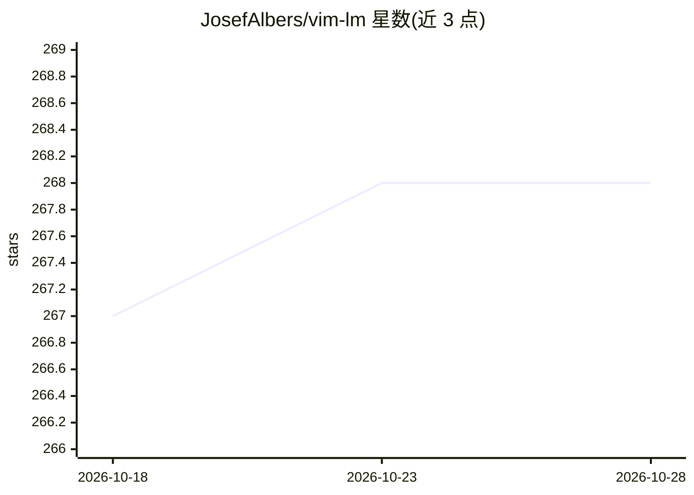

# JosefAlbers/vim-lm

⭐ 268 · Python · Apache-2.0 · 推送 2026-07-31 · [GitHub](https://github.com/JosefAlbers/vim-lm) · 个人维护

**Vim/NeoVim 的本地 AI 编码助手插件（MLX 离线运行）**

以 pip 安装的 Vim/NeoVim 插件，将 LLM 引入编辑器工作流：Insert 模式下生成代码补全（可带 --repo 仓库级上下文）、Normal/Visual 模式下进行上下文对话、代码块替换与部署，支持 !include/!deploy/!continue 等内联指令链接自定义工作流。100% 本地执行，依赖 Apple Silicon（M 系列）与 MLX 兼容模型，通过 ~/vimlm/cfg.json 配置模型（默认 DeepSeek-R1-Distill-Qwen-7B-4bit）与键位。限制：硬件绑定 Apple Silicon，需 Python 3.12.8、Vim 9.1 或 NeoVim 0.10.4。

## 筛选速览

| 维度 | 判定 | 备注 |
|---|---|---|
| AI 角色 | `ai-native` | 本体是模型或模型工具 |
| 许可风险 | `permissive` | Apache-2.0 |
| 部署形态 | `self-host` | docker 或自建部署 |
| 模型依赖 | — | README 未给出锁定关系 |
| 硬件要求 | — | 无带数字的原话,不猜 |
| 安装摩擦 | `low` | 无编译、无系统依赖或容器化 |
| 成熟度 | — | 结构信号不足 |

## 能力要点

- Insert 模式代码补全，--repo 提供仓库级上下文
- 100% 本地执行，MLX 兼容模型（默认 DeepSeek-R1-Distill-Qwen-7B-4bit）
- !include/!deploy/!continue 内联指令可链式组合为可复用命令
- 对话式迭代生成、选中代码块替换与代码部署到目录

## 适用场景

- 在 Vim/NeoVim 内离线完成代码补全与生成
- 以自然语言重构、替换选中的代码块
- 结合仓库文件与 shell 输出作为上下文执行调试/生成任务

## 场景标签

`代码生成` · 领域:编码与开发

## 证据(README 行号)

> L5: VimLM brings the power of AI directly into your Vim workflow. Maintain focus with keyboard-driven interactions while
> L11: - **Offline First** - 100% local execution with MLX-compatible models

## 星数曲线

2026-10-18 267 → 2026-10-28 268（+1）

---
*卡片 v1 · prompt 1.4 · 生成 2026-10-22 · 置信度 mid · 依据 README sha `c73ddd7c81bf` · [字段定义](../../DATASET.md)*
