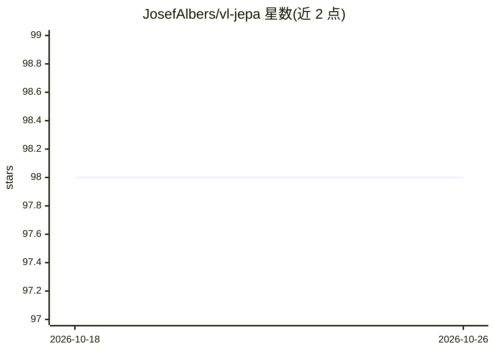

# JosefAlbers/vl-jepa

⭐ 98 · Python · Apache-2.0 · 推送 2025-12-31 · [GitHub](https://github.com/JosefAlbers/vl-jepa) · [官网](https://youtube.com/shorts/aHkfDrOB9Lg?feature=share) · 个人维护

**Apple MLX 上的 VL-JEPA 教育性简化实现**

基于 Apple MLX 框架对 VL-JEPA（视觉-语言联合嵌入预测架构）论文的简化教学实现，将 PaliGemma 视觉语言模型改编为 JEPA 架构，README 注明目前仅为初步适配。面向希望在 Apple 芯片上学习或复现 JEPA 类自监督方法的开发者。README 仅 5 行，未提供安装命令、依赖说明或使用示例，信息量有限。

## 筛选速览

| 维度 | 判定 | 备注 |
|---|---|---|
| AI 角色 | `ai-native` | 本体是模型或模型工具 |
| 许可风险 | `permissive` | Apache-2.0 |
| 部署形态 | `None` |  |
| 模型依赖 | — | README 未给出锁定关系 |
| 硬件要求 | — | 无带数字的原话,不猜 |
| 安装摩擦 | `low` | 无编译、无系统依赖或容器化 |
| 成熟度 | `idea` | |

## 能力要点

- VL-JEPA 论文的简化教学实现
- 基于 Apple MLX 构建
- 将 PaliGemma VLM 改编为 JEPA 架构

## 适用场景

- 在 Apple 芯片上学习 JEPA 自监督方法的实现
- 复现或扩展 VL-JEPA 论文架构

## 场景标签

`多模态` `教程课程` · 领域:学习与行业

## 证据(README 行号)

> L3: A simplified, educational implementation of the VL-JEPA (Vision-Language Joint Embedding Predictive Architecture) pa
> L5: Adapts the **PaliGemma** VLM into a JEPA architecture (for now).

## 星数曲线

2026-10-18 98 → 2026-10-26 98（+0）

---
*卡片 v1 · prompt 1.4 · 生成 2026-10-23 · 置信度 mid · 依据 README sha `cb3bf55cdbbe` · [字段定义](../../DATASET.md)*
