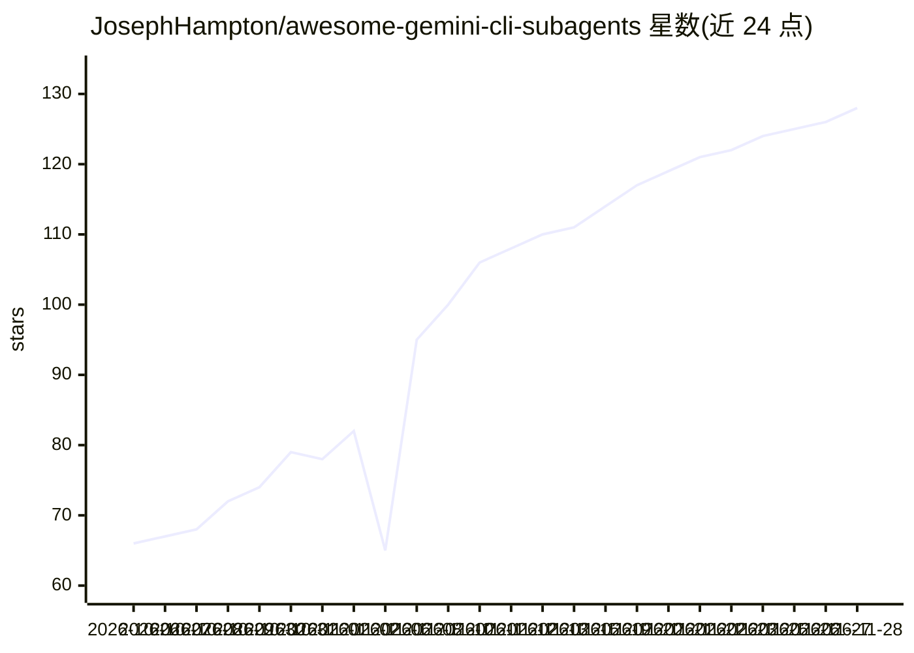

# JosephHampton/awesome-gemini-cli-subagents

⭐ 128 · Shell · CC0-1.0 · 推送 2026-11-19 · [GitHub](https://github.com/JosephHampton/awesome-gemini-cli-subagents) · [官网](https://josephhampton.github.io/awesome-gemini-cli-subagents/) · 个人维护

**为 Gemini CLI / Antigravity CLI 提供的 81 个子代理清单库**

策展的开源子代理库：每个子代理是单个 Markdown 文件，含系统提示词、工具范围与守则，覆盖代码审查、安全审计、测试、DevOps、数据/AI 与 17 种语言框架专家等类别。每个文件同时提供 Gemini CLI 与 Antigravity CLI 两种格式，改动经 CI 自动校验；通过 curl 一行脚本或 git clone 安装到用户级/项目级目录，由主代理委派或以 @名称直接调用。许可证为 CC0-1.0。

## 筛选速览

| 维度 | 判定 | 备注 |
|---|---|---|
| AI 角色 | `ai-knowledge` | 知识聚合/清单类 |
| 许可风险 | `viral` | CC0-1.0 |
| 部署形态 | `self-host` | docker 或自建部署 |
| 模型依赖 | — | README 未给出锁定关系 |
| 硬件要求 | — | 无带数字的原话,不猜 |
| 安装摩擦 | `low` | 无编译、无系统依赖或容器化 |
| 成熟度 | — | 结构信号不足 |

## 能力要点

- 81 个子代理按核心开发、语言、DevOps、安全、数据/AI 等 8 类组织
- 每个子代理同时提供 Gemini CLI 与 Antigravity CLI 两种格式并经 CI 校验
- 工具范围隔离：审查类代理无文件写入工具，仅报告问题
- curl 一行安装脚本与 agy plugin 安装方式

## 适用场景

- 给 Gemini CLI 项目按需装一组代码审查/安全审计子代理
- 从 Gemini CLI 迁移到 Antigravity 时转换代理配置格式
- 按 Recipes 组合多个子代理完成安全预检或重构流程

## 场景标签

`精选清单` `编码 Agent` `代码审查` `网络安全` · 领域:编码与开发

## 证据(README 行号)

> L19: Gemini CLI and Antigravity CLI both support **subagents**: specialist AI coding assistants the main agent delegates
> L21: This repo is a curated, open-source library of production-ready subagents. Every agent is a single Markdown file wi

## 星数曲线

2026-10-26 66 → 2026-11-28 128（+62）

---
*卡片 v1 · prompt 1.4 · 生成 2026-11-28 · 置信度 mid · 依据 README sha `18b818110bf3` · [字段定义](../../DATASET.md)*
