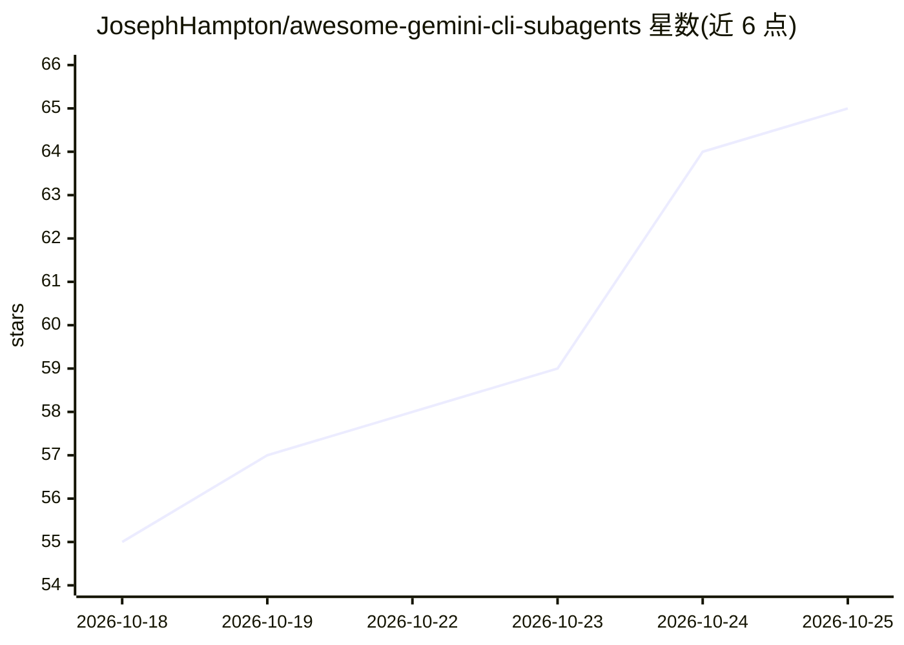

# JosephHampton/awesome-gemini-cli-subagents

⭐ 66 · Shell · CC0-1.0 · 推送 2026-10-22 · [GitHub](https://github.com/JosephHampton/awesome-gemini-cli-subagents) · 个人维护

**面向 Gemini CLI/Antigravity 的 81 个子代理提示词策展库**

策展式子代理集合：为 Gemini CLI 与 Antigravity CLI 提供 81 个以 Markdown+YAML frontmatter 编写的专家子代理，覆盖核心开发、17 种语言专家、DevOps、测试、安全、数据/AI 与产品编排等类别。每个子代理拥有独立系统提示词、工具白名单与上下文窗口，主代理按描述路由委派。提供 curl 一行安装脚本、git clone 与 Antigravity 插件安装三种方式，格式转换由 CI 自动校验；限制是 Gemini 格式的代理文件需经转换才能用于 Antigravity。

## 筛选速览

| 维度 | 判定 | 备注 |
|---|---|---|
| AI 角色 | `ai-knowledge` | 知识聚合/清单类 |
| 许可风险 | `viral` | CC0-1.0 |
| 部署形态 | `self-host` | docker 或自建部署 |
| 模型依赖 | — | README 未给出锁定关系 |
| 硬件要求 | — | 无带数字的原话,不猜 |
| 安装摩擦 | `low` | 无编译、无系统依赖或容器化 |
| 成熟度 | — | 结构信号不足 |

## 能力要点

- 81 个子代理以双格式（Gemini/Antigravity）提供并在 CI 中自动校验
- 每个代理为单 Markdown 文件，含系统提示词、工具白名单与上下文隔离
- 提供 tech-lead-orchestrator 等组合工作流 Recipes
- curl 一行安装脚本、git clone 与 agy 插件三种安装途径

## 适用场景

- 为 Gemini CLI/Antigravity CLI 按需安装代码评审、安全审计等专家子代理
- 通过编排代理将大任务拆解并委派给多个专家子代理
- 参考子代理格式（frontmatter 字段、工具白名单）编写自定义代理

## 场景标签

`精选清单` `提示工程` · 领域:Agent 开发

## 证据(README 行号)

> L18: Gemini CLI and Antigravity CLI both support **subagents**: specialist assistants the main agent hands work to. Each
> L20: This repo is a curated library of them. Every agent is a single Markdown file with a real, opinionated system promp

## 星数曲线

2026-10-18 55 → 2026-10-25 65（+10）

---
*卡片 v1 · prompt 1.4 · 生成 2026-10-24 · 置信度 mid · 依据 README sha `234910eaaa1b` · [字段定义](../../DATASET.md)*
