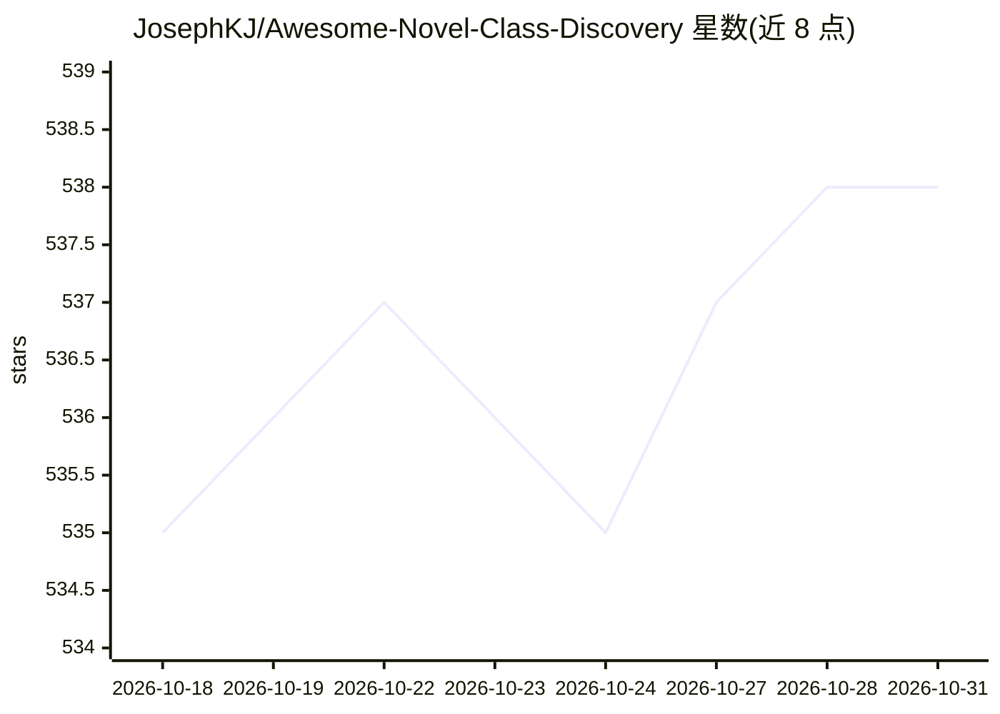

# JosephKJ/Awesome-Novel-Class-Discovery

⭐ 538 · 推送 2026-09-04 · [GitHub](https://github.com/JosephKJ/Awesome-Novel-Class-Discovery) · 个人维护

**Novel Class Discovery 研究论文清单：面向科研人员**

一个收录 Novel Class Discovery (NCD) 及其变体研究论文的 awesome 清单。NCD 是在无标注数据池中自动发现新类别的机器学习问题，与聚类的区别在于可访问不相交类别的有标注数据。清单按综述、预印本、按年份会议（CVPR/ICLR/ICML 等）组织条目，多数条目附论文链接，部分附代码链接；另列出问题设定术语（GCD、NCDwF、Fed-GCD 等）并指向演化树图与综述。清单自述为非穷尽列表。

## 筛选速览

| 维度 | 判定 | 备注 |
|---|---|---|
| AI 角色 | `ai-knowledge` | 知识聚合/清单类 |
| 许可风险 | `none` | — |
| 部署形态 | `None` |  |
| 模型依赖 | — | README 未给出锁定关系 |
| 硬件要求 | — | 无带数字的原话,不猜 |
| 安装摩擦 | `low` | 无编译、无系统依赖或容器化 |
| 成熟度 | — | 结构信号不足 |

## 能力要点

- 按综述、预印本、会议年份组织 NCD 论文条目
- 覆盖 GCD、Class-iNCD、Fed-GCD、Active-GCD 等多种问题设定变体
- 部分条目附论文与代码双链接
- 提供问题设定术语表与演化树图（指向综述）

## 适用场景

- 查找 NCD/GCD 方向的代表性论文与代码
- 了解类别发现问题设定的术语与变体谱系
- 按会议（CVPR/ICLR/ICML）跟踪最新研究进展

## 场景标签

`精选清单` · 领域:学习与行业

## 证据(README 行号)

> L1: # Awesome-Novel-Class-Discovery
> L5: Here, we provide a non-exhaustive list of papers that study NCD.

## 星数曲线

2026-10-18 535 → 2026-10-31 538（+3）

---
*卡片 v1 · prompt 1.4 · 生成 2026-10-21 · 置信度 high · 依据 README sha `f0eddde80755` · [字段定义](../../DATASET.md)*
