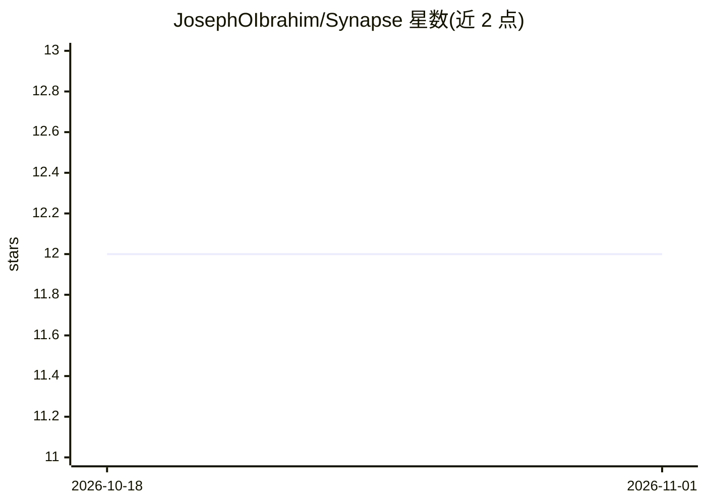

# JosephOIbrahim/Synapse

⭐ 12 · Python · MIT · 推送 2026-10-24 · [GitHub](https://github.com/JosephOIbrahim/Synapse) · 个人维护

**Houdini 内的 AI 助手面板：用自然语言建节点并保持艺术家控制**

运行在 Houdini 22 内的 AI 助手面板，面向 Houdini 艺术家：用户用自然语言描述任务，模型选择工具，面板的 worker 策略先检查该工具再执行——默认只允许只读工具和 inform 级编辑（建节点、设参数、连线、建材质），拒绝删除节点、任意 Python/VEX、渲染与导出。提供经 Houdini 22.0.400 验证的 Solaris 配方（如 Scatter），构建前读取场景中相机/世界/碰撞体，缺失即返回 UNKNOWN 不构建；每次构建带收据与一键 Revert（仅回退本轮 SYNAPSE 的 undo 组）。模型可接本地（如 Ollama）或云端。安装提供 Windows Setup 或源码 ZIP；Setup 未签名，需自行比对 SHA-256。

## 筛选速览

| 维度 | 判定 | 备注 |
|---|---|---|
| AI 角色 | `ai-native` | 本体是模型或模型工具 |
| 许可风险 | `permissive` | MIT |
| 部署形态 | `None` |  |
| 模型依赖 | local-ok | 支持本地模型 |
| 硬件要求 | — | 无带数字的原话,不猜 |
| 安装摩擦 | `low` | 无编译、无系统依赖或容器化 |
| 成熟度 | — | 结构信号不足 |

## 能力要点

- 默认 worker 策略拒绝危险操作（删节点/任意 Python/VEX/渲染/导出）
- 验证过的 Solaris 配方：构建前读取场景，缺失或歧义返回 UNKNOWN 不构建
- 构建收据带一键 Revert，仅回退本轮 SYNAPSE 的 undo 组
- 支持本地（Ollama）或云端模型接入

## 适用场景

- 在 Houdini 里用自然语言生成和编辑节点网络
- 沿高斯溅射世界做散布等经配方验证的 Solaris 构建
- 在保留手工检查与 Undo 控制的前提下加速场景搭建

## 场景标签

`AI 助手` · 领域:对话与助手

## 证据(README 行号)

> L3:  Your AI assistant inside Houdini. Describe a task. Inspect the nodes. Keep creative control.
> L30: 3. Open **Connect models**. Choose a provider and model; add its key if needed.
> L98: In a scratch scene, send:

## 星数曲线

2026-10-18 12 → 2026-11-01 12（+0）

---
*卡片 v1 · prompt 1.4 · 生成 2026-11-01 · 置信度 high · 依据 README sha `23e34d6c3679` · [字段定义](../../DATASET.md)*
