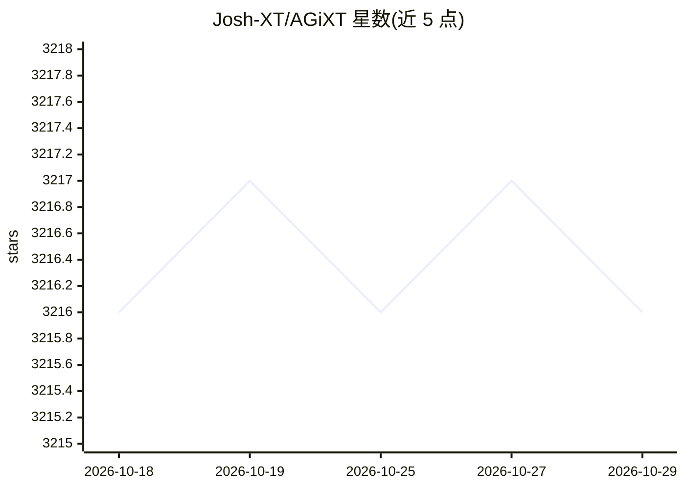

# Josh-XT/AGiXT

⭐ 3,216 · Python · MIT · 推送 2026-07-28 · [GitHub](https://github.com/Josh-XT/AGiXT) · [官网](https://AGiXT.com) · 个人维护

**AI Agent 自动化平台：多提供商编排任务执行与工作流**

面向开发者和企业的 AI 自动化平台，通过自然语言交互编排指令管理与复杂任务执行。支持 OpenAI、Anthropic、Google、Azure 及本地模型等多提供商接入，提供 40+ 内置扩展（覆盖特斯拉车辆控制、企业资产管理等场景）、自适应记忆、插件系统、OAuth/多租户等企业功能，以及基于 WebSockets、webhooks 的实时集成。安装方式为 pip install agixt 后运行 agixt start，详细文档位于独立文档站。

## 筛选速览

| 维度 | 判定 | 备注 |
|---|---|---|
| AI 角色 | `ai-ecosystem` | LLM/agent 周边工具 |
| 许可风险 | `permissive` | MIT |
| 部署形态 | `library` | 以包/库形式分发 |
| 模型依赖 | — | README 未给出锁定关系 |
| 硬件要求 | — | 无带数字的原话,不猜 |
| 安装摩擦 | `low` | 无编译、无系统依赖或容器化 |
| 成熟度 | — | 结构信号不足 |

## 能力要点

- 40+ 内置扩展，覆盖智能家居、企业工作流等场景
- 多提供商支持：OpenAI、Anthropic、Google、Azure 及本地模型
- 工作流自动化：链式调用多服务构建自动化序列
- 企业功能：OAuth、多租户、安全与合规特性

## 适用场景

- 通过自然语言对话控制智能设备与企业系统
- 编排跨多个 AI 提供商的自动化工作流
- 构建带自适应记忆与插件的 Agent 应用

## 场景标签

`工作流自动化` `Agent 框架` · 领域:Agent 开发

## 证据(README 行号)

> L17: > **AGiXT is a comprehensive AI automation platform that transforms how you interact with artificial intelligence. 
> L21: AGiXT is not just another AI framework—it's a complete automation platform that bridges the gap between artificial 
> L26: - **Multi-Provider Support**: Work with OpenAI, Anthropic, Google, Azure, local models, and more

## 星数曲线

2026-10-18 3,216 → 2026-10-29 3,216（+0）

---
*卡片 v1 · prompt 1.4 · 生成 2026-10-20 · 置信度 high · 依据 README sha `f388e2f3851e` · [字段定义](../../DATASET.md)*
