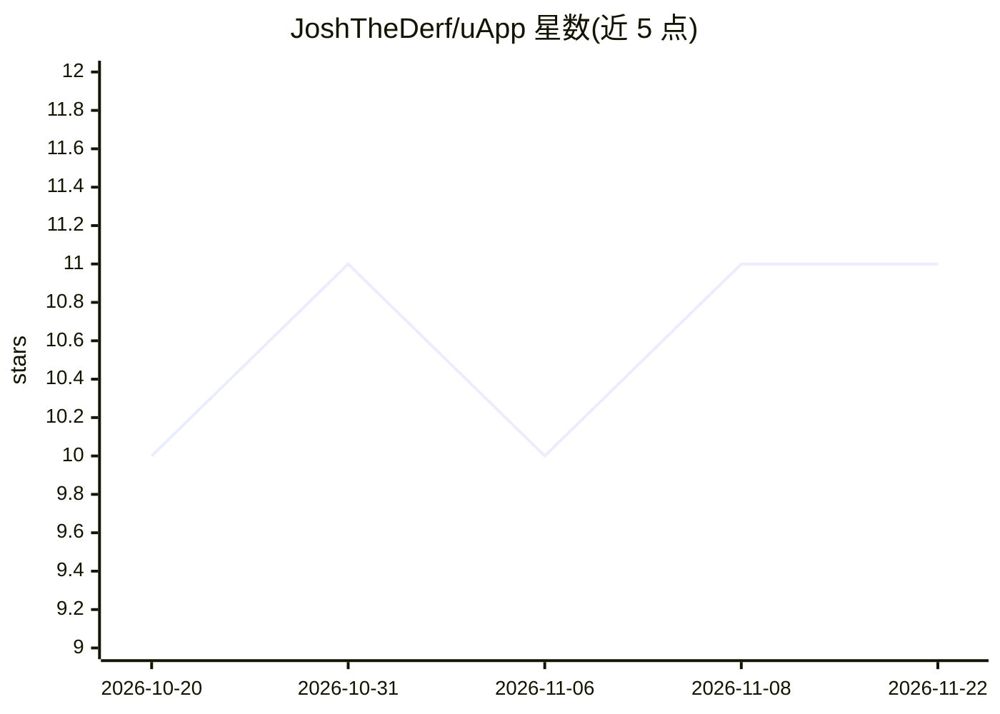

# JoshTheDerf/uApp

⭐ 11 · Rust · MIT · 推送 2026-10-20 · [GitHub](https://github.com/JoshTheDerf/uApp) · [官网](https://thederf.com/uapp/demo) · 个人维护

**运行单文件 SQLite 归档应用、内置 AI 修改能力的运行时**

uApp 是一个桌面/移动运行时，打开 .uapp 文件——即包含 web 应用文件、数据表和用户数据的 SQLite 归档。内置 web server 提供应用页面，附带 AI 聊天窗口（子 agent、修订历史）、SQL 浏览器和文件浏览器，可由 AI 或人工构建与修改应用。提供 Linux/Windows/macOS 安装包与 Android APK，另有 WebAssembly 版在线演示和服务器托管模式。作者定位场景是用 AI 快速构建内部小工具并像共享表格一样分发。

## 筛选速览

| 维度 | 判定 | 备注 |
|---|---|---|
| AI 角色 | `ai-ecosystem` | LLM/agent 周边工具 |
| 许可风险 | `permissive` | MIT |
| 部署形态 | `desktop` | 安装包/桌面程序 |
| 模型依赖 | — | README 未给出锁定关系 |
| 硬件要求 | — | 无带数字的原话,不猜 |
| 安装摩擦 | `low` | 无编译、无系统依赖或容器化 |
| 成熟度 | — | 结构信号不足 |

## 能力要点

- .uapp = SQLite 归档，含应用代码与用户数据，可作模板/带数据分发
- 内嵌 AI 聊天窗口：子 agent、多会话、文件修订历史存于 .uapp 内
- API 密钥与 MCP 凭据仅存本机，不随 .uapp 文件传播
- CLI 支持打开/导出模板/合并更新，同一二进制可作服务器托管

## 适用场景

- 用 AI 构建内部小工具并邮件/网盘直接分发给同事
- 用户自行修改应用副本并保留数据，出问题时回滚排查
- 服务器上托管 .uapp 应用或应用库

## 场景标签

`AI 助手` `编码 Agent` `代码生成` · 领域:编码与开发

## 证据(README 行号)

> L3: # uApp - single-file shareable apps
> L59: 1. An embedded AI chat window with tools to allow building out a frontend and database. Sub-agents, multiple chats,
> L140: The same `uapp` binary does this. On a server, build it with `--no-default-features` (no Tauri or webview):

## 星数曲线

2026-10-20 10 → 2026-11-22 11（+1）

---
*卡片 v1 · prompt 1.4 · 生成 2026-11-19 · 置信度 high · 依据 README sha `607f4f232d89` · [字段定义](../../DATASET.md)*
