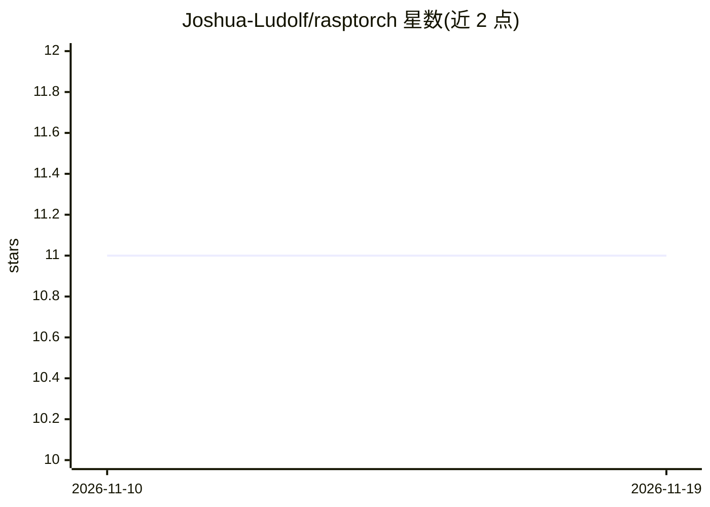

# Joshua-Ludolf/rasptorch

⭐ 11 · Python · MIT · 推送 2026-11-13 · [GitHub](https://github.com/Joshua-Ludolf/rasptorch) · [官网](https://rasptorch.streamlit.app/) · 个人维护

**在树莓派等受限硬件上通过 Vulkan GPU 运行神经网络的 PyTorch 风格库**

受 PyTorch 启发的实验性深度学习库，聚焦在树莓派 5 等资源受限硬件上利用 GPU（Vulkan 计算着色器编译为 SPIR-V）运行神经网络。提供 NumPy autograd 的 CPU 后端、实验性 Vulkan 后端、可选 OpenCL 与 CUDA 后端及运行时后端注册 API；内置 Tensor 运算、Linear/MLP/CNN/GRU/Transformer 等层、SGD 优化器与训练工具、checkpoint 持久化，以及 CLI 交互 shell 和 Streamlit Web UI，附基准测试工具。通过 pip 安装，GPU 后端需额外 extras 与 glslc 等依赖。

## 筛选速览

| 维度 | 判定 | 备注 |
|---|---|---|
| AI 角色 | `ai-native` | 本体是模型或模型工具 |
| 许可风险 | `permissive` | MIT |
| 部署形态 | `library` | 以包/库形式分发 |
| 模型依赖 | — | README 未给出锁定关系 |
| 硬件要求 | — | 无带数字的原话,不猜 |
| 安装摩擦 | `medium` | 含编译或系统依赖之一 |
| 成熟度 | — | 结构信号不足 |

## 能力要点

- 多后端抽象：NumPy CPU、实验性 Vulkan、OpenCL（clvk）、CUDA（CuPy），可运行时注册连接
- Vulkan 后端针对树莓派 4/5 优化，支持离散 GPU 的 VRAM 常驻与分块 GEMM 内核
- 内置基准测试工具与 Vulkan 内核自动调优（--vulkan-kernel auto）
- 附带 Agent Skill，供 Claude Code、Cursor 等 AI agent 通过 CLI 操作库

## 适用场景

- 在树莓派 5 上用 GPU 加速训练小型神经网络
- 对比不同计算后端（NumPy/Vulkan/OpenCL/CUDA）的 matmul 性能
- 通过 CLI 或 Web UI 交互式构建、训练、保存模型

## 场景标签

 · 领域:深度学习框架/边缘计算

## 证据(README 行号)

> L3: rasptorch is an experimental deep learning library inspired by PyTorch, built with a singular focus: **making comple
> L83: * **Layers:** Includes standard neural network blocks: `Linear`, `MLP`, `CNN`, `GRU`, `Transformer`, normalization 

## 星数曲线

2026-11-10 11 → 2026-11-19 11（+0）

---
*卡片 v1 · prompt 1.4 · 生成 2026-11-19 · 置信度 high · 依据 README sha `527a06e5a86e` · [字段定义](../../DATASET.md)*
