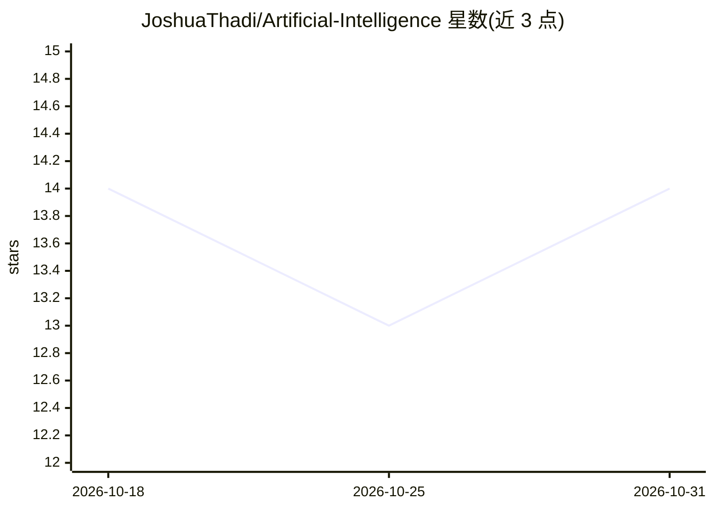

# JoshuaThadi/Artificial-Intelligence

⭐ 14 · Jupyter Notebook · MIT · 推送 2026-06-08 · [GitHub](https://github.com/JoshuaThadi/Artificial-Intelligence) · 个人维护

**AI 学习知识库：课程讲义、技术清单与路线图合集**

个人维护的 AI 学习资料仓库：包含 AI Roadmap、10 部分课程讲义（提示工程、推理参数、生成式 AI、Agentic AI 等，覆盖 Q-Learning 到 PPO/SAC 的强化学习内容），并列举所用的 Python 库（NumPy/Pandas/Scikit-learn/TensorFlow/PyTorch/NLTK/SpaCy/Transformers、Vosk/gTTS/pyttsx3）与外部 AI 工具链接（Groq、Cursor、Windsurf、Bolt 等）。README 自述包含聊天机器人、语音助手与机器学习模型项目及交互演示，但可见部分以教学文本为主，未见本仓库的安装或运行命令。

## 筛选速览

| 维度 | 判定 | 备注 |
|---|---|---|
| AI 角色 | `ai-knowledge` | 知识聚合/清单类 |
| 许可风险 | `permissive` | MIT |
| 部署形态 | `None` |  |
| 模型依赖 | — | README 未给出锁定关系 |
| 硬件要求 | — | 无带数字的原话,不猜 |
| 安装摩擦 | `low` | 无编译、无系统依赖或容器化 |
| 成熟度 | — | 结构信号不足 |

## 能力要点

- AI Roadmap 与 10 部分课程体系（提示工程→Agentic AI→LLM）
- 提示工程技术与推理参数（temperature/top-p/top-k 等）讲解
- 技术栈清单：TensorFlow/PyTorch/Transformers 与语音 STT/TTS 库
- 附 PartyRock 构建示例与外部资源链接

## 适用场景

- 按路线图系统学习 AI 从基础到部署的知识
- 查阅提示工程与推理参数的概念说明
- 了解 AI 开发常用库与工具生态的链接索引

## 场景标签

`教程课程` `精选清单` · 领域:学习与行业

## 证据(README 行号)

> L119: ## Artificial Intelligence A-Z
> L120: **Master Artificial Intelligence from foundations to advanced deployment with this comprehensive 10-part curriculu
> L124:  1] Prompt Engineering
> L160:  Generative Artificial Intelligence

## 星数曲线

2026-10-18 14 → 2026-10-31 14（+0）

---
*卡片 v1 · prompt 1.4 · 生成 2026-10-31 · 置信度 mid · 依据 README sha `9ad3253b2a0c` · [字段定义](../../DATASET.md)*
