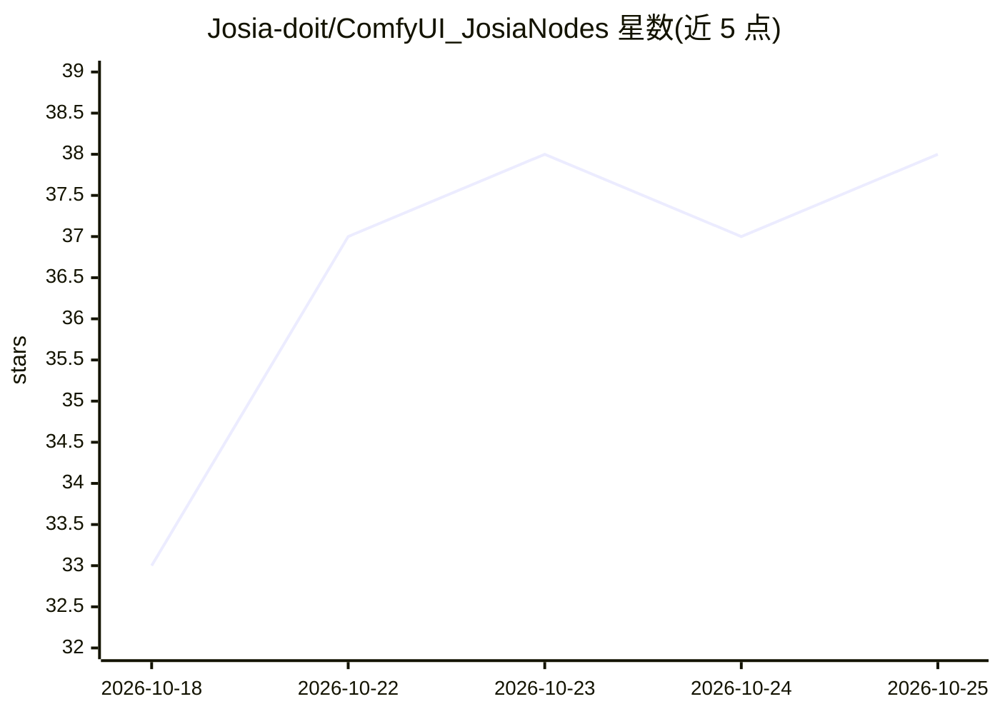

# Josia-doit/ComfyUI_JosiaNodes

⭐ 38 · JavaScript · MIT · 推送 2026-10-20 · [GitHub](https://github.com/Josia-doit/ComfyUI_JosiaNodes) · 个人维护 · 中文 README

**ComfyUI 实用节点集：文本编码、多图加载、图像缩放等 18 个节点**

由 B 站创作者吉客AI（JeekAI）维护的 ComfyUI 自定义节点包，注册 18 个节点项，覆盖文生图/图生图一体化 CLIP/VAE 编码（最多融合 10 张参考图）、多图批量加载与等比缩放、图像裁切拼接、随机种子管理、LoRA 堆叠（1-10 组、触发词面板）、显存缓存清理、模型加载（AIO Checkpoint/独立 UNET/GGUF）等。全中文界面、原生控件、纯 Python 标准库实现、不依赖第三方库。因注册表安全扫描未放行，以 git clone / 手动拷贝为分发主渠道，不保证通过 ComfyUI 注册表自动扫描。

## 筛选速览

| 维度 | 判定 | 备注 |
|---|---|---|
| AI 角色 | `ai-ecosystem` | LLM/agent 周边工具 |
| 许可风险 | `permissive` | MIT |
| 部署形态 | `None` |  |
| 模型依赖 | — | README 未给出锁定关系 |
| 硬件要求 | — | 无带数字的原话,不猜 |
| 安装摩擦 | `medium` | 含编译或系统依赖之一 |
| 成熟度 | — | 结构信号不足 |

## 能力要点

- 文生图+图生图一体化编码节点，最多融合 10 张参考图，适配 Qwen-Image-Edit / FLUX.2 等模型
- 多图加载列表模式自动逐张执行下游节点，适合批量打标工作流
- LoRA 堆叠 1-10 组独立控制，带触发词与预览图本地管理及导入导出
- 纯 Python 标准库实现，零第三方依赖

## 适用场景

- 在 ComfyUI 中搭建文生图/图生图与多参考图工作流
- 批量加载多张图片并自动逐张跑反推打标、保存文本
- 管理多组 LoRA 及其触发词、预览图
- 低显存环境下清理无用显存缓存同时保持模型常驻

## 场景标签

`图像生成` · 领域:内容生成

## 证据(README 行号)

> L1: # Josia ComfyUI 自定义节点集
> L18: 1. Josia文本编码（JosiaEncoder）
> L29: 12. Josia模型加载（JosiaCheckpointPlus）

## 星数曲线

2026-10-18 33 → 2026-10-25 38（+5）

---
*卡片 v1 · prompt 1.4 · 生成 2026-10-25 · 置信度 high · 依据 README sha `b5e40c8cc132` · [字段定义](../../DATASET.md)*
