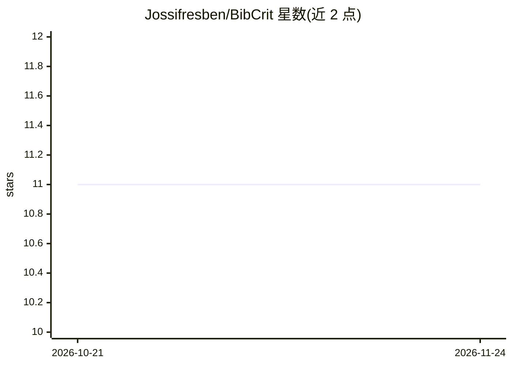

# Jossifresben/BibCrit

⭐ 11 · Python · Apache-2.0 · 推送 2026-11-07 · [GitHub](https://github.com/Jossifresben/BibCrit) · [官网](https://bibcrit.app/) · 个人维护

**面向圣经文本批评学者的 AI 辅助分析 Web 工具**

以 Flask Web 应用形式提供 16 个分析工具，覆盖 MT/LXX 分歧比对、死海古卷多见证对比、文士倾向剖析、神学修订检测、教父引文追踪、回译工作台、手稿谱系可视化等。多数工具采用混合架构：确定性代码从语料计算数据，Claude 负责分类、假设生成与评论，代码再对模型输出做校验。支持中英之外以英文和西班牙文界面运行；需 Anthropic API key，月度消费有上限控制，分析结果按 SHA256 键缓存于 Supabase 或磁盘。

## 筛选速览

| 维度 | 判定 | 备注 |
|---|---|---|
| AI 角色 | `ai-native` | 本体是模型或模型工具 |
| 许可风险 | `permissive` | Apache-2.0 |
| 部署形态 | `library` | 以包/库形式分发 |
| 模型依赖 | locked-api |  |
| 硬件要求 | — | 无带数字的原话,不猜 |
| 安装摩擦 | `low` | 无编译、无系统依赖或容器化 |
| 成熟度 | — | 结构信号不足 |

## 能力要点

- 16 个文本批评工具，含 DSS/SP/Peshitta/他尔根等多见证比对
- 代码与模型混合管线：代码计算数值，Claude 分类并生成假设，代码校验输出
- 结果按 SHA256 缓存（Supabase + 磁盘 JSON），并做月度美元消费上限检查
- SSE 流式返回分析进度，界面提供英文与西班牙文

## 适用场景

- 比较某段经文在 MT、LXX 与死海古卷中的见证差异
- 为 LXX 希腊文逐词推测其背后可能的希伯来文读法
- 分析新约对旧约的引用采用哪种文本形式
- 在论文中获取 BibTeX/SBL 等格式的引用信息

## 场景标签

`科研工具` `AI 助手` · 领域:对话与助手

## 证据(README 行号)

> L10: Free, open-access web tool for biblical textual criticism at bibcrit.com. Compare MT, LXX, and Dead Sea Scrolls; re
> L30: |1|**MT/LXX Divergence Analyzer**|`/divergence`|Word-level Hebrew/Greek comparison with alignment scoring. Claude c
> L67: |AI analysis|Anthropic Python SDK 0.30+ · model: `claude-opus-4-7`|

## 星数曲线

2026-10-21 11 → 2026-11-24 11（+0）

---
*卡片 v1 · prompt 1.4 · 生成 2026-11-19 · 置信度 high · 依据 README sha `33a5f1335379` · [字段定义](../../DATASET.md)*
