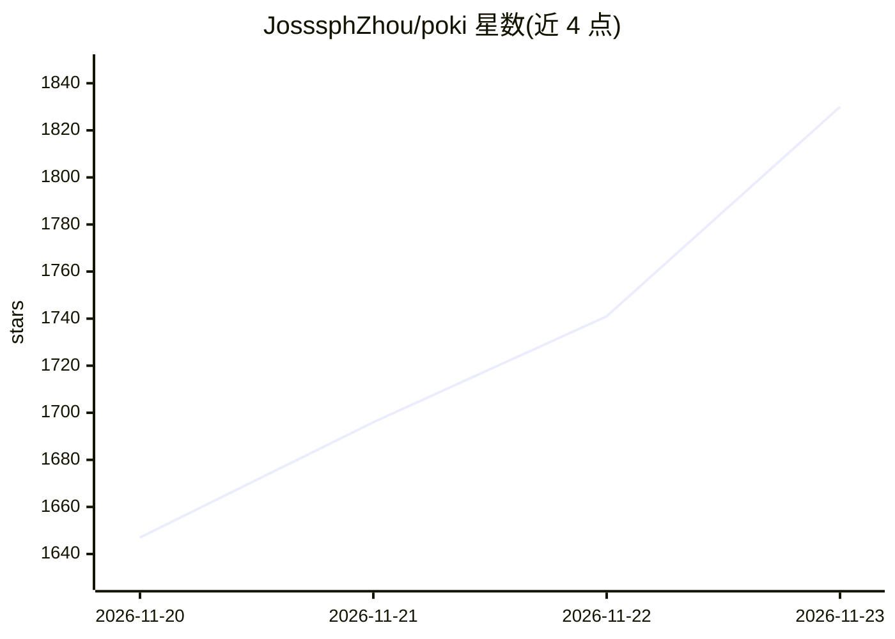

# JosssphZhou/poki

⭐ 1,830 · Swift · AGPL-3.0 · 推送 2026-11-22 · [GitHub](https://github.com/JosssphZhou/poki) · [官网](https://poki.bot) · 个人维护

**在 iPhone 上直接运行、代用户操作手机应用的 GUI agent 应用**

Poki 是安装在 iPhone 上的开源 agent 应用：读取屏幕并在真实应用内点击、输入、滑动，替代用户完成多步骤操作。安装需先经 Mac 或 Windows PC 通过 USB 完成，之后可脱离电脑独立运行；模型侧由用户自备账号（ChatGPT Plus/Pro 登录、各家 API key 或 OpenAI 兼容服务器）。支付、删除、Wallet 类操作需用户逐次确认；锁屏或需审批时暂停。设备要求 iOS 18+，并需配置外链路由与签名续期。

## 筛选速览

| 维度 | 判定 | 备注 |
|---|---|---|
| AI 角色 | `ai-native` | 本体是模型或模型工具 |
| 许可风险 | `viral` | AGPL-3.0 |
| 部署形态 | `desktop` | 安装包/桌面程序 |
| 模型依赖 | — | README 未给出锁定关系 |
| 硬件要求 | — | 无带数字的原话,不猜 |
| 安装摩擦 | `low` | 无编译、无系统依赖或容器化 |
| 成熟度 | `idea` | |

## 能力要点

- 在 iPhone 上独立运行，读取屏幕并在真实应用内点击/输入/滑动
- 支持 ChatGPT Plus/Pro 登录或 Anthropic/OpenAI/Gemini/DeepSeek/OpenRouter 等 API key 及 OpenAI 兼容服务器
- 支付、删除、Wallet 操作强制用户确认；动态岛中后台运行
- 保存技能可从主屏幕或语音启动

## 适用场景

- 让 agent 代我完成点外卖、查天气、建备忘录等日常多步操作
- 把常用流程存成技能，一键或语音复跑
- 不开电脑的情况下自动化我的手机

## 场景标签

`GUI 自动化` · 领域:效率与自动化

## 证据(README 行号)

> L23: Poki is an open-source iPhone agent that operates your entire iPhone for you. The Poki app runs directly on your iP
> L48: 2. **Connect and add your model account.** Accept **Trust**, turn on Developer Mode and Automation Mode when iOS as

## 星数曲线

2026-11-20 1,647 → 2026-11-23 1,830（+183）

---
*卡片 v1 · prompt 1.4 · 生成 2026-11-20 · 置信度 high · 依据 README sha `2a3536204ac6` · [字段定义](../../DATASET.md)*
