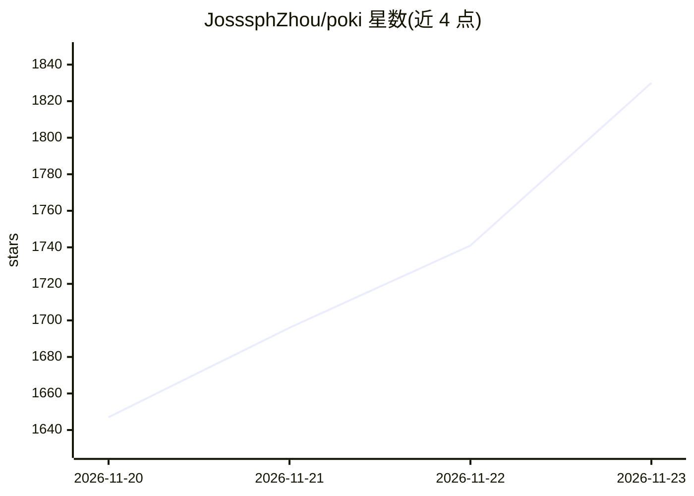

# JosssphZhou/poki

⭐ 1,830 · Swift · AGPL-3.0 · 推送 2026-11-22 · [GitHub](https://github.com/JosssphZhou/poki) · [官网](https://poki.bot) · 个人维护 · 中文 README

**在 iPhone 上运行的开源手机操作 agent 应用**

Poki 是直接安装并运行在 iPhone 上的开源 agent 应用：读取屏幕并在真实应用内执行点击、输入、滑动等操作，支持聊天、Action Button 或 Siri 触发，可将常用流程保存为技能一键或语音启动。模型侧使用用户自己的账号（ChatGPT Plus/Pro 登录或多家 API key）。支付、删除、Wallet 等操作会暂停等待用户确认；锁屏或需审批时自动暂停。安装需先从 Mac 或 Windows PC 完成，之后可脱离电脑独立运行。

## 筛选速览

| 维度 | 判定 | 备注 |
|---|---|---|
| AI 角色 | `ai-native` | 本体是模型或模型工具 |
| 许可风险 | `viral` | AGPL-3.0 |
| 部署形态 | `desktop` | 安装包/桌面程序 |
| 模型依赖 | — | README 未给出锁定关系 |
| 硬件要求 | — | 无带数字的原话,不猜 |
| 安装摩擦 | `low` | 无编译、无系统依赖或容器化 |
| 成熟度 | `idea` | |

## 能力要点

- 应用直接运行在 iPhone 上，可脱离电脑独立操作
- 读取屏幕并在真实应用中执行点击、输入、滑动
- 支付/删除/Wallet 操作强制用户确认
- 支持保存技能，从主屏幕或语音启动重复流程

## 适用场景

- 让 agent 代为完成查询天气、记笔记、订餐等日常操作
- 把每天重复的手机操作流程保存为技能一键执行
- 用自己的模型账号驱动手机自动化任务

## 场景标签

`GUI 自动化` · 领域:效率与自动化

## 证据(README 行号)

> L23: Poki is an open-source iPhone agent that operates your entire iPhone for you. The Poki app runs directly on your iP
> L48: 2. **Connect and add your model account.** Accept **Trust**, turn on Developer Mode and Automation Mode when iOS as

## 星数曲线

2026-11-20 1,647 → 2026-11-23 1,830（+183）

---
*卡片 v1 · prompt 1.4 · 生成 2026-11-23 · 置信度 high · 依据 README sha `bae1ed46cc73` · [字段定义](../../DATASET.md)*
