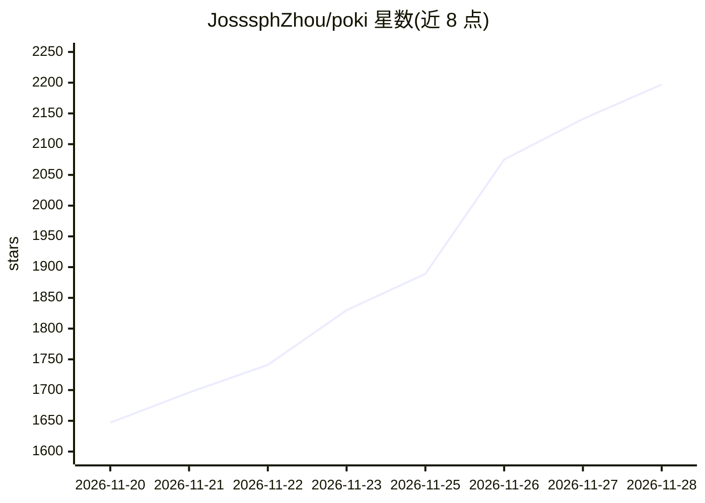

# JosssphZhou/poki

⭐ 2,197 · Swift · AGPL-3.0 · 推送 2026-11-27 · [GitHub](https://github.com/JosssphZhou/poki) · [官网](https://poki.bot) · 个人维护 · 中文 README

**在 iPhone 上直接运行、代用户操作手机应用的 GUI agent 应用**

Poki 是一个安装并运行在 iPhone 上的开源 agent 应用：读取屏幕，在真实应用内执行点按、输入、滑动等操作，用户通过自有模型账号（ChatGPT Plus/Pro 登录或 API key）驱动。支付、删除、Wallet 等操作强制弹出确认；支持聊天指令、Action Button 长按或 Siri 触发，可保存常用技能，安装后无需连接电脑独立运行。需 iOS 18+ 的 iPhone，初次安装需经 Mac 或 Windows PC 完成，免费 Apple 账号签名为 7 天需续期。

## 筛选速览

| 维度 | 判定 | 备注 |
|---|---|---|
| AI 角色 | `ai-native` | 本体是模型或模型工具 |
| 许可风险 | `viral` | AGPL-3.0 |
| 部署形态 | `desktop` | 安装包/桌面程序 |
| 模型依赖 | — | README 未给出锁定关系 |
| 硬件要求 | — | 无带数字的原话,不猜 |
| 安装摩擦 | `low` | 无编译、无系统依赖或容器化 |
| 成熟度 | `idea` | |

## 能力要点

- 读取屏幕并在真实应用内执行点按/输入/滑动
- 使用用户自有模型账号：ChatGPT 登录或多家 API key
- 支付、删除、Wallet 操作强制确认
- 安装后独立于电脑运行，支持保存技能与语音对话

## 适用场景

- 让 agent 在 iPhone 上代为完成查天气、建备忘录等日常操作
- 把重复步骤保存为技能一键或语音启动
- 跨两个应用并行执行任务（iPhone 分屏）

## 场景标签

`GUI 自动化` `AI 助手` · 领域:效率与自动化

## 证据(README 行号)

> L23: Poki is an open-source iPhone agent that operates your entire iPhone for you. The Poki app runs directly on your iP
> L48: 2. **Connect and add your model account.** Accept **Trust**, turn on Developer Mode and Automation Mode when iOS as

## 星数曲线

2026-11-20 1,647 → 2026-11-28 2,197（+550）

---
*卡片 v1 · prompt 1.4 · 生成 2026-11-26 · 置信度 high · 依据 README sha `a4261487a04d` · [字段定义](../../DATASET.md)*
