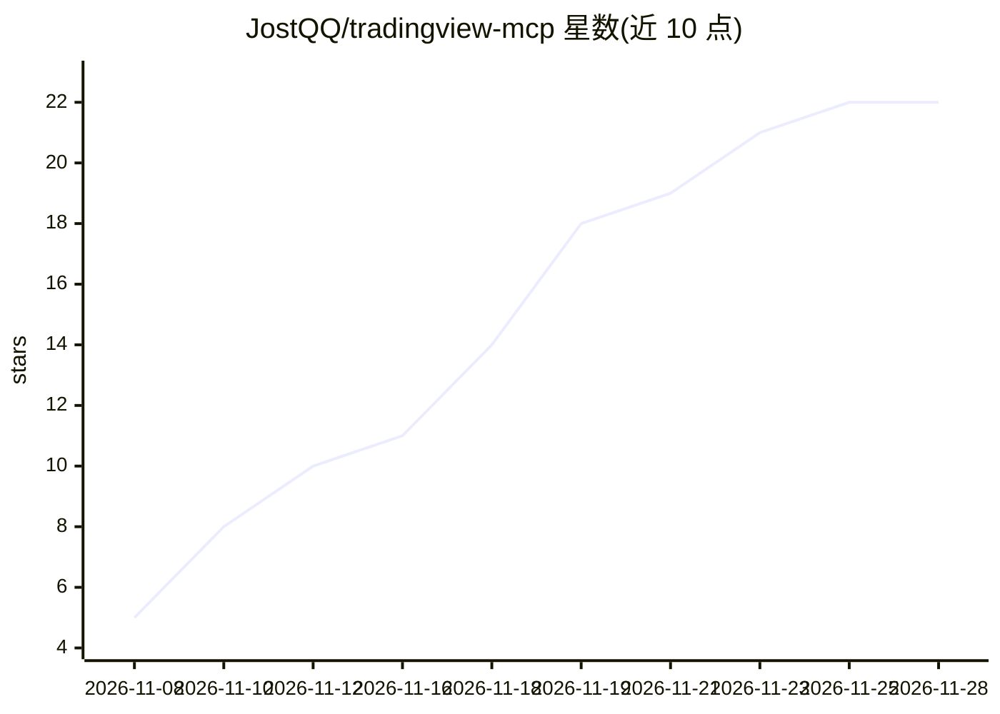

# JostQQ/tradingview-mcp

⭐ 22 · JavaScript · NOASSERTION · 推送 2026-10-10 · [GitHub](https://github.com/JostQQ/tradingview-mcp) · 个人维护

**给 agent 提供 TradingView Desktop 自动化能力的 MCP 服务器**

通过 Chrome DevTools Protocol 连接运行中的 TradingView Desktop，将其内部 API 暴露为 104 个 MCP 工具：覆盖 Pine Script 全生命周期（编写、编译、云端保存/版本管理）、Strategy Tester 完整回测读取（40+ 指标、逐笔交易、净值曲线）、参数批量扫描、图表/布局/回放/警报/自选列表控制与 DOM 级 UI 自动化。不使用计算机视觉或截图，输出结构化 JSON。要求 Windows 系统并已安装 TradingView Desktop，Node.js ≥ 20。

## 筛选速览

| 维度 | 判定 | 备注 |
|---|---|---|
| AI 角色 | `ai-ecosystem` | LLM/agent 周边工具 |
| 许可风险 | `none` | NOASSERTION |
| 部署形态 | `desktop` | 安装包/桌面程序 |
| 模型依赖 | — | README 未给出锁定关系 |
| 硬件要求 | — | 无带数字的原话,不猜 |
| 安装摩擦 | `low` | 无编译、无系统依赖或容器化 |
| 成熟度 | — | 结构信号不足 |

## 能力要点

- 104 个 MCP 工具分 13 组，通过应用内部 API 而非视觉识别交互
- 完整读取回测结果：40+ 指标、逐笔交易、净值曲线与 buy&hold 基线
- 一次调用完成参数矩阵扫描，结果追加至 JSONL 台账
- 受保护脚本注册表与本地自动备份的安全模型

## 适用场景

- 让 agent 自动编写并回测 Pine Script 策略
- 批量扫描策略参数并导出结果离线分析
- 自动化管理图表、布局、警报与自选列表

## 场景标签

`金融量化` · 领域:学习与行业

## 证据(README 行号)

> L17: TradingView's desktop app is normally driven by hand: click the editor, paste code in, press buttons, screenshot th
> L88: - **Standard stdio MCP server** — works with Hermes Agent, Claude Desktop, Cursor, or anything speaking the Model C

## 星数曲线

2026-11-08 5 → 2026-11-28 22（+17）

---
*卡片 v1 · prompt 1.4 · 生成 2026-11-18 · 置信度 high · 依据 README sha `c72c56a7dad7` · [字段定义](../../DATASET.md)*
