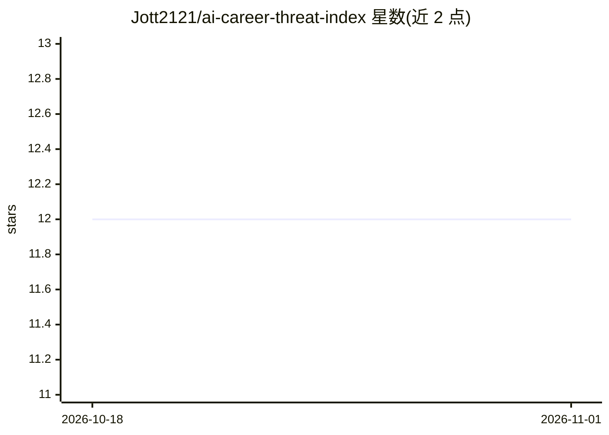

# Jott2121/ai-career-threat-index

⭐ 12 · Python · MIT · 推送 2026-07-23 · [GitHub](https://github.com/Jott2121/ai-career-threat-index) · [官网](https://jott2121.github.io/ai-career-threat-index/) · 组织维护

**300 个美国职业的 AI 替代风险开放评分数据集**

对 300 个美国职业按 0–100 分评估 AI 替代风险，每个角色发布四个子分数（taskAutomation、toolMaturity、adoption、agenticExposure）及书面理由，公式为 taskAutomation×(0.45+0.30·toolMaturity/100+0.25·adoption/100)+0.10·agenticExposure。分数为基于公开评分标准（rubric）的结构化编辑估计，参考 O*NET 任务清单、BLS OES 数据，自述非测量值。数据以 JSON/CSV/SOC 映射表提供，附零依赖 MCP 服务器（npm 的 threat-index-mcp）供 Claude 等 MCP 客户端查询，季度更新，MIT 许可。

## 筛选速览

| 维度 | 判定 | 备注 |
|---|---|---|
| AI 角色 | `ai-knowledge` | 知识聚合/清单类 |
| 许可风险 | `permissive` | MIT |
| 部署形态 | `library` | 以包/库形式分发 |
| 模型依赖 | — | README 未给出锁定关系 |
| 硬件要求 | — | 无带数字的原话,不猜 |
| 安装摩擦 | `low` | 无编译、无系统依赖或容器化 |
| 成熟度 | — | 结构信号不足 |

## 能力要点

- 300 个职业各含四个公开子分数与书面理由
- SOC 2018 全部 867 个职业代码映射到已评分角色
- 零依赖 MCP 服务器（threat-index-mcp）供 AI 助手直接查询
- 数据集由每角色源文件确定性再生成，30+ 完整性检查

## 适用场景

- 查询自身职业的 AI 替代风险与子分数构成
- 通过 SOC 代码将任意美国职业映射到评分邻位
- 在 Python/R/pandas 中分析薪资与风险的相关性
- 让 Claude 等 MCP 客户端直接比较职业暴露度

## 场景标签

 · 领域:劳动力市场/开放数据

## 证据(README 行号)

> L25: The AI Career Threat Index scores **300 US professions** on AI displacement risk,
> L70: |`data/ai-career-threat-index.json`|Full dataset: 300 roles, sub-scores, rationales, tasks, defense skills, quarter

## 星数曲线

2026-10-18 12 → 2026-11-01 12（+0）

---
*卡片 v1 · prompt 1.4 · 生成 2026-11-01 · 置信度 high · 依据 README sha `039dfc182d11` · [字段定义](../../DATASET.md)*
