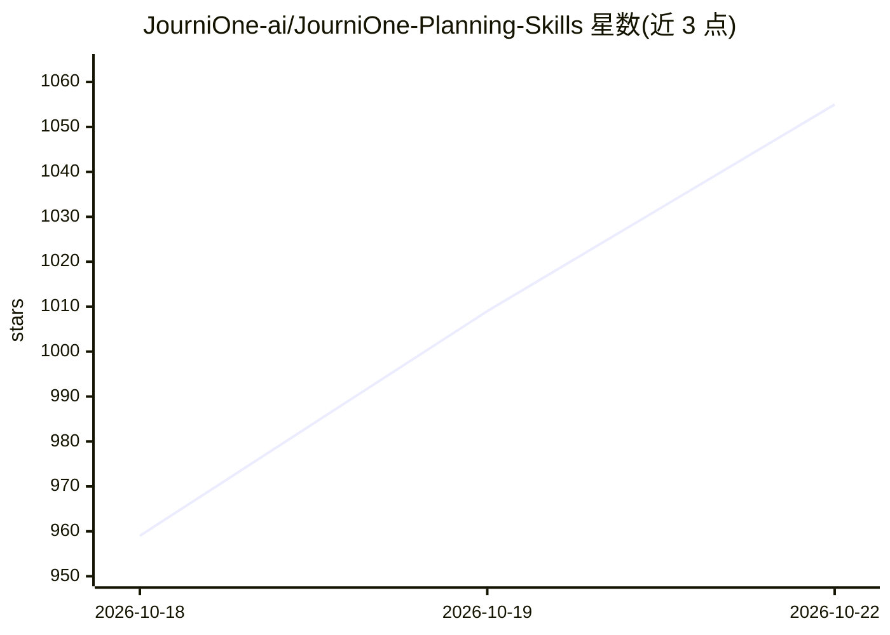

# JourniOne-ai/JourniOne-Planning-Skills

⭐ 1,092 · JavaScript · 推送 2026-10-11 · [GitHub](https://github.com/JourniOne-ai/JourniOne-Planning-Skills) · [官网](https://journione.ai/) · 组织维护 · 中文 README

**给 AI 客户端的旅行规划 Skill：生成逐日路线与可分享 Travel Journal**

面向 agent 客户端的 Skill 包（显示名 Travel Journal Creator），以自然语言对话完成旅行规划：根据兴趣与节奏生成逐日路线，衔接 TourMind 酒店比价预订（聚合携程、飞猪、Booking.com 等 100+ 渠道）与 Kiwi.com 航班搜索，并产出带 Journal 视图与地图视图、可分享的交互式旅行指南。安装时自动准备 TourMind hotel Skill 与 Kiwi MCP 依赖；指南创建默认连接 journione.ai，无需本地 MCP 服务，捆绑脚本需 Node.js 22+。

## 筛选速览

| 维度 | 判定 | 备注 |
|---|---|---|
| AI 角色 | `ai-ecosystem` | LLM/agent 周边工具 |
| 许可风险 | `none` | — |
| 部署形态 | `None` |  |
| 模型依赖 | — | README 未给出锁定关系 |
| 硬件要求 | — | 无带数字的原话,不猜 |
| 安装摩擦 | `low` | 无编译、无系统依赖或容器化 |
| 成熟度 | — | 结构信号不足 |

## 能力要点

- 自然语言生成逐日路线与可探索的 Travel Journal（Journal 视图 + Map 视图）
- TourMind 聚合 100+ 酒店渠道比价（含携程、飞猪、美团、Booking.com 等）
- Kiwi.com 航班搜索与行程衔接，仅在用户请求时触发
- 分享链接免登录可查看，指南生成无需 JourniOne token 或本地 MCP 服务

## 适用场景

- 和 AI 对话规划旅行逐日行程并生成可视化指南
- 按路线和预算比价酒店并继续完成预订
- 把行程指南分享给朋友一起讨论计划

## 场景标签

 · 领域:旅行规划/Agent 技能

## 证据(README 行号)

> L57: 1. Import JourniOne-Planning-Skills through your client's Skill manager, or follow the installation guide to use a 
> L58: 2. The installation agent checks and prepares the required **TourMind hotel Skill** and **Kiwi MCP**, reusing exist
> L61: Creating a JourniOne guide requires no JourniOne token or local JourniOne MCP service. It connects to journione.ai 

## 星数曲线

2026-10-18 959 → 2026-10-22 1,055（+96）

---
*卡片 v1 · prompt 1.4 · 生成 2026-10-21 · 置信度 high · 依据 README sha `e98c6700c246` · [字段定义](../../DATASET.md)*
