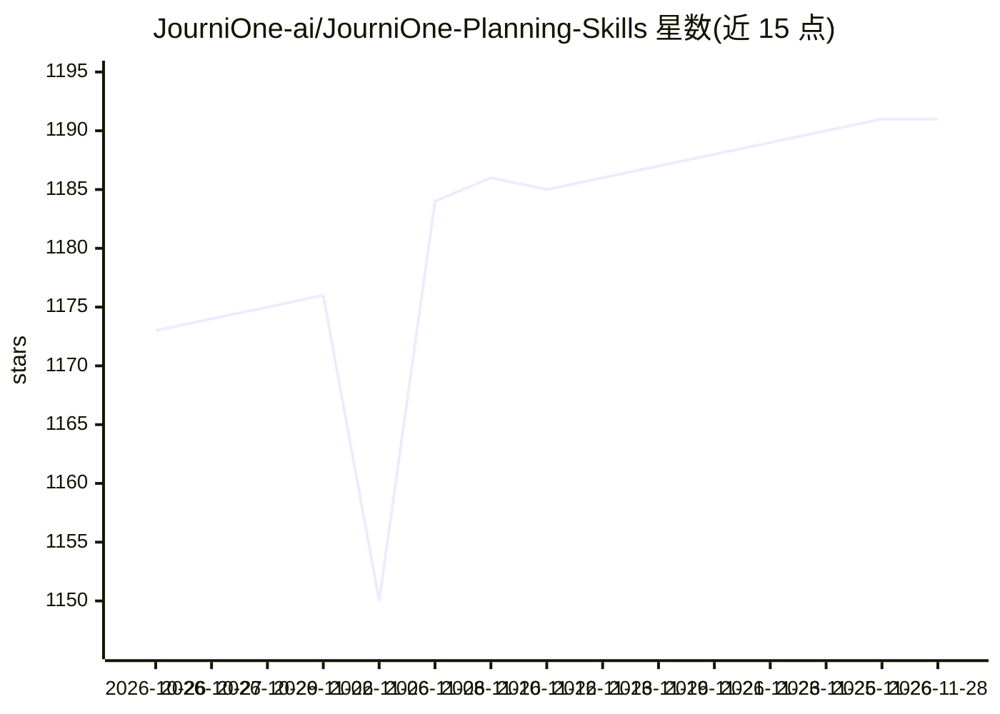

# JourniOne-ai/JourniOne-Planning-Skills

⭐ 1,191 · JavaScript · MIT · 推送 2026-11-25 · [GitHub](https://github.com/JourniOne-ai/JourniOne-Planning-Skills) · [官网](https://journione.ai/) · 组织维护 · 中文 README

**面向旅行者的规划 Skill：逐日路线、酒店比价与可分享旅行指南**

以 agent Skill 形式分发的旅行规划工具：从出行想法生成逐日路线，按兴趣与节奏安排景点、餐饮与休息；确认后生成含 Journal 视图与 Map 视图的交互式 Travel Journal，可分享链接免登录查看。按需接入 TourMind 酒店搜索（聚合 100+ 渠道比价）与 Kiwi.com 机票搜索；默认连接 journione.ai 云端服务，无需本地 token 或 MCP 服务。需 Node.js 22+，客户端需支持 web 搜索、文件访问、HTTPS 请求与远程 MCP。

## 筛选速览

| 维度 | 判定 | 备注 |
|---|---|---|
| AI 角色 | `ai-native` | 本体是模型或模型工具 |
| 许可风险 | `permissive` | MIT |
| 部署形态 | `None` |  |
| 模型依赖 | — | README 未给出锁定关系 |
| 硬件要求 | — | 无带数字的原话,不猜 |
| 安装摩擦 | `low` | 无编译、无系统依赖或容器化 |
| 成熟度 | — | 结构信号不足 |

## 能力要点

- 逐日路线规划，支持导入既有行程、照片与笔记
- TourMind 酒店比价聚合 100+ 渠道（含携程/飞猪/Agoda/Booking.com）
- Kiwi.com 机票搜索与行程衔接
- Journal/Map 双视图旅行指南与免登录分享链接

## 适用场景

- 从旅行想法生成可逐日执行的行程方案
- 沿路线搜索并比较酒店价格与取消条款
- 生成图文旅行指南分享给同行朋友

## 场景标签

 · 领域:旅行/生活工具

## 证据(README 行号)

> L16: Start with a travel idea. JourniOne helps you plan each day, find hotels that fit your route and budget, and bring 
> L62: 1. Import JourniOne-Planning-Skills through your client's Skill manager, or follow the installation guide to use a 
> L66: Creating a JourniOne guide requires no JourniOne token or local JourniOne MCP service. It connects to journione.ai 

## 星数曲线

2026-10-26 1,173 → 2026-11-28 1,191（+18）

---
*卡片 v1 · prompt 1.4 · 生成 2026-11-26 · 置信度 high · 依据 README sha `8171062d44db` · [字段定义](../../DATASET.md)*
