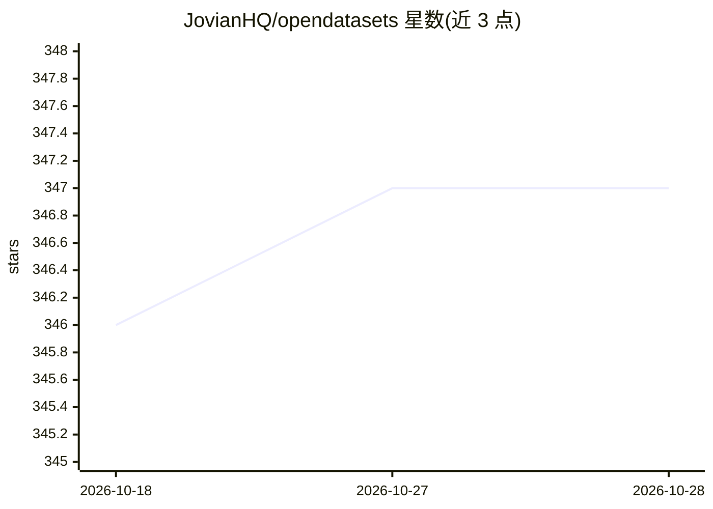

# JovianHQ/opendatasets

⭐ 347 · Python · MIT · 推送 2026-01-10 · [GitHub](https://github.com/JovianHQ/opendatasets) · 组织维护

**从 Kaggle、Google Drive 等在线来源下载数据集的 Python 库**

提供 od.download 辅助函数，在 Jupyter notebook 或 Python 脚本中通过一行命令下载 Kaggle、公开 Google Drive 链接或原始文件 URL 的数据集。Kaggle 下载走官方 API，需配置 kaggle.json 凭据（可放于 notebook 同目录自动读取）；竞赛数据集需先接受竞赛规则。另内置若干精选数据集（如 Stack Overflow 开发者调查、OWID Covid-19、StateOfJS 历年调查），传入 Dataset ID 即可下载。由 Jovian 团队维护，pip 安装。

## 筛选速览

| 维度 | 判定 | 备注 |
|---|---|---|
| AI 角色 | `ai-ecosystem` | LLM/agent 周边工具 |
| 许可风险 | `permissive` | MIT |
| 部署形态 | `library` | 以包/库形式分发 |
| 模型依赖 | — | README 未给出锁定关系 |
| 硬件要求 | — | 无带数字的原话,不猜 |
| 安装摩擦 | `low` | 无编译、无系统依赖或容器化 |
| 成熟度 | — | 结构信号不足 |

## 能力要点

- od.download 一行命令下载数据集
- 支持 Kaggle、Google Drive 公开链接与原始文件 URL
- Kaggle 官方 API 凭据（kaggle.json）自动读取
- 内置 Stack Overflow 调查、OWID Covid-19 等精选数据集（按 Dataset ID 下载）

## 适用场景

- 在 notebook 中直接拉取 Kaggle 数据集做分析
- 不用手动下载即可获取公开 Google Drive 数据
- 通过 Dataset ID 快速获取 Stack Overflow 开发者调查等精选数据

## 场景标签

 · 领域:数据科学/数据获取工具

## 证据(README 行号)

> L3: `opendatasets` is a Python library for downloading datasets from online sources like Kaggle and Google Drive using a
> L27: `opendatasets` uses the Kaggle Official API for donwloading dataset from Kaggle. Follow these steps to find your AP

## 星数曲线

2026-10-18 346 → 2026-10-28 347（+1）

---
*卡片 v1 · prompt 1.4 · 生成 2026-10-21 · 置信度 high · 依据 README sha `39492070ee92` · [字段定义](../../DATASET.md)*
