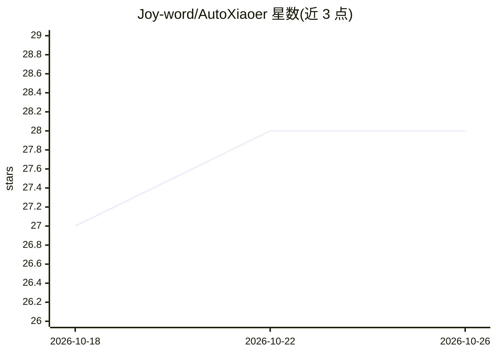

# Joy-word/AutoXiaoer

⭐ 28 · Kotlin · MIT · 推送 2026-10-16 · [GitHub](https://github.com/Joy-word/AutoXiaoer) · 个人维护 · 中文 README

**安卓手机上的端侧视觉 Agent 应用：像人一样操作手机完成自然语言任务**

原生 Android 应用，纯端侧运行、无需电脑与 ADB。采用双 Agent 架构：Controller（LLM Agent，ReAct 循环做任务规划）+ Executor（Phone Agent，视觉模型分析截图并执行点击/滑动/输入等操作），可选第三个 Expresser（BrainLLM）负责人格化措辞。支持任意 OpenAI 兼容 API，推荐智谱 autoglm-phone（限时免费）或 ModelScope 配置。触发渠道包括定时任务、通知监听、微信扫码远程控制（ClawBot）。控制后端可选 Shizuku 或无障碍服务，内置高德 MCP 与自定义 MCP 管理。要求 Android 7.0+，通过 Releases 页下载 APK 安装。

## 筛选速览

| 维度 | 判定 | 备注 |
|---|---|---|
| AI 角色 | `ai-native` | 本体是模型或模型工具 |
| 许可风险 | `permissive` | MIT |
| 部署形态 | `desktop` | 安装包/桌面程序 |
| 模型依赖 | — | README 未给出锁定关系 |
| 硬件要求 | — | 无带数字的原话,不猜 |
| 安装摩擦 | `low` | 无编译、无系统依赖或容器化 |
| 成熟度 | — | 结构信号不足 |

## 能力要点

- Controller + Executor 双 Agent 架构，可选 Expresser 人格措辞模型
- 视觉驱动操作任意已安装应用，无需 ADB 与电脑
- 定时任务、通知触发、微信远程控制等多触发渠道
- Shizuku / 无障碍双控制后端，内置高德 MCP 与自定义 MCP 管理
- 任务经验记忆按应用/联系人分类积累，提升重复任务效率

## 适用场景

- 用自然语言让手机自动完成跨应用操作
- 闲置手机改造为 24/7 自动化伴侣，远程通过微信下发指令
- 定时或在收到特定通知时自动执行预设任务

## 场景标签

`GUI 自动化` · 领域:效率与自动化

## 证据(README 行号)

> L15: Auto Xiao'er is a pure on-device native Android agent app that operates your phone visually just like a human, seam
> L22: - 🤖 **Dual Agent**: **Controller** (LLM Agent) + **Executor** (Phone Agent) collaborate on planning and screen acti
> L39: - ✅ **Screen Understanding**: Screenshot → Vision model analysis → Output action commands

## 星数曲线

2026-10-18 27 → 2026-10-26 28（+1）

---
*卡片 v1 · prompt 1.4 · 生成 2026-10-26 · 置信度 high · 依据 README sha `d53a8e335c15` · [字段定义](../../DATASET.md)*
