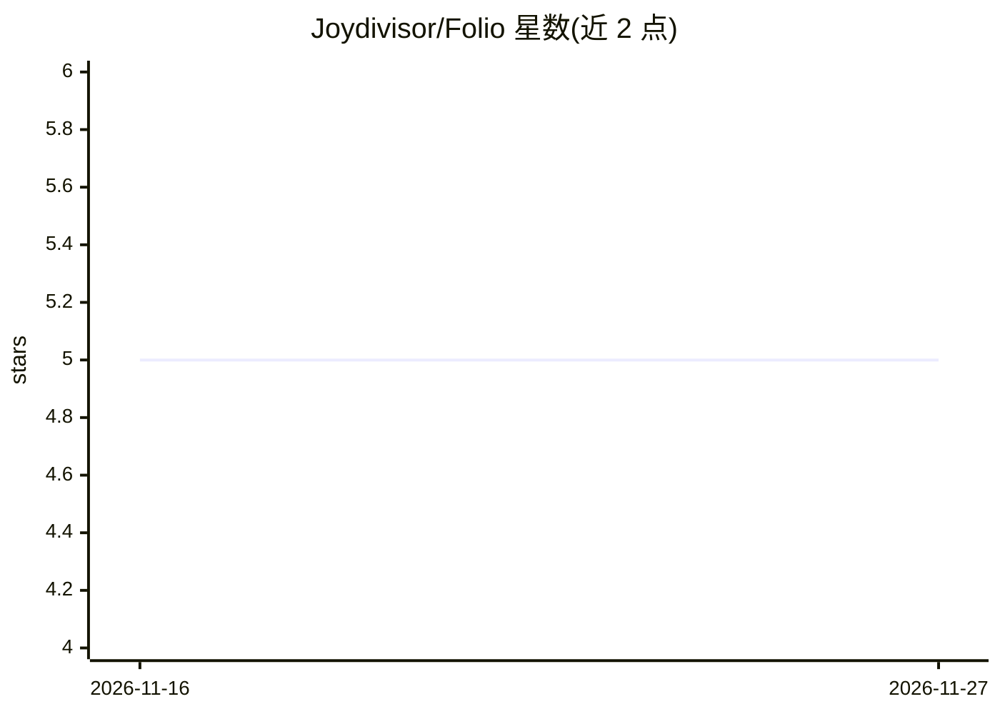

# Joydivisor/Folio

⭐ 5 · JavaScript · GPL-3.0 · 推送 2026-11-20 · [GitHub](https://github.com/Joydivisor/Folio) · [官网](https://getfolio.pages.dev/) · 个人维护 · 中文 README

**本地优先的文献阅读工作台：批注笔记与 AI 交互图示**

以本地文献库为中心的桌面阅读工作区，覆盖 PDF/DOCX/TXT/Markdown 阅读、批注、来源链接笔记、中英文本地 OCR 与全文搜索；AI 部分通过用户自选的服务商与 API Key 提供带来源解释、交互式画布、流程图/推导/对照表等九种输出格式及参数化 SVG 图示。文献与笔记保存在本机，不配置 AI 也可使用；不支持 EPUB、Zotero 双向同步或写回原 PDF。提供 Windows/macOS/Ubuntu 安装包及源码运行方式。

## 筛选速览

| 维度 | 判定 | 备注 |
|---|---|---|
| AI 角色 | `ai-native` | 本体是模型或模型工具 |
| 许可风险 | `viral` | GPL-3.0 |
| 部署形态 | `None` |  |
| 模型依赖 | — | README 未给出锁定关系 |
| 硬件要求 | — | 无带数字的原话,不猜 |
| 安装摩擦 | `low` | 无编译、无系统依赖或容器化 |
| 成熟度 | — | 结构信号不足 |

## 能力要点

- 带来源引用的可编辑 AI 回答画布，九种输出格式各自校验并自动重试
- 扫描 PDF 本地 OCR 与中英文全文搜索
- 本地优先：文献、批注、笔记与密钥存储在设备上，支持工作区备份
- 支持 OpenAI 兼容与 Claude 原生接口，用户自带 API Key

## 适用场景

- 阅读文献时对选中段落获得带来源的解释并整理成笔记
- 离线管理本地文献库并做高亮、批注与分类
- 通过 AI 生成流程图、推导和图示辅助理解难懂内容

## 场景标签

`知识库管理` `科研工具` `OCR` `文档问答` · 领域:知识与检索

## 证据(README 行号)

> L7: Folio 将文献阅读与 AI 解释放在同一工作区。文献、批注、笔记和阅读位置保存在本机；AI 使用你自己选择的模型服务。不配置 AI 也可以阅读和管理文献。
> L51: - **边读边问**：选中或拖入原文，直接获得带来源的解释。回答进入可编辑画布，流程图、完整推导、对照表等按内容嵌入，无需专门的触发词。
> L60: 在设置中选择服务商、模型并填写自己的 API Key。支持 OpenAI 兼容 Chat Completions 接口，以及 Claude 原生 Messages 接口；DeepSeek、OpenAI 和 Gemini 有对应配置

## 星数曲线

2026-11-16 5 → 2026-11-27 5（+0）

---
*卡片 v1 · prompt 1.4 · 生成 2026-11-21 · 置信度 high · 依据 README sha `077669c01b94` · [字段定义](../../DATASET.md)*
