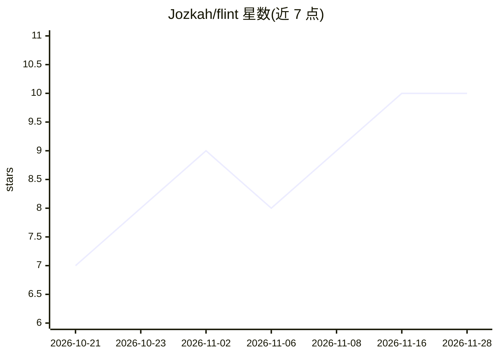

# Jozkah/flint

⭐ 10 · TypeScript · Apache-2.0 · 推送 2026-11-27 · [GitHub](https://github.com/Jozkah/flint) · 个人维护

**本地优先的桌面 AI 工作区：本地模型聊天与代理文件协作**

开源 Jan 应用的独立分支，基于 Tauri 的桌面端 AI 工作区。提供本地模型聊天、多项目分屏会话，以及 Cowork 代理模式：代理在沙箱或托管项目副本中读写文件、执行命令，写前展示 diff、按块应用、使用 Git worktree 与检查点，每步操作需用户批准。模型来源为 Hugging Face 的 GGUF/MLX 下载、本地导入或自带密钥接入 OpenAI/Anthropic 兼容云端。无遥测，密钥存于系统钥匙串。CLI 以独立二进制发布并上架 brew/scoop/npm。

## 筛选速览

| 维度 | 判定 | 备注 |
|---|---|---|
| AI 角色 | `ai-native` | 本体是模型或模型工具 |
| 许可风险 | `permissive` | Apache-2.0 |
| 部署形态 | `desktop` | 安装包/桌面程序 |
| 模型依赖 | local-ok | 支持本地模型 |
| 硬件要求 | — | 无带数字的原话,不猜 |
| 安装摩擦 | `high` | 编译与系统依赖俱全 |
| 成熟度 | — | 结构信号不足 |

## 能力要点

- Cowork 代理：沙箱执行、写前 diff 审核、Git worktree、检查点与回滚
- 多模型讨论房间（moderator、预算、@mentions、最终综合）
- 并行子代理与六种内置角色（explorer/planner/implementer/reviewer/tester/security）
- 支持 GGUF/MLX 本地模型，可选 CUDA 引擎附加包，Vulkan 为回退

## 适用场景

- 在自己的电脑上与本地模型聊天并处理文档
- 让代理修改代码项目并逐块审核变更
- 接入自己的云模型 API 密钥获得桌面客户端
- 从 Jan 迁移既有数据继续使用

## 场景标签

`编码 Agent` `AI 助手` `聊天机器人` · 领域:编码与开发

## 证据(README 行号)

> L3: **A local-first AI workspace for your desktop.** Chat with models on your own computer, let an agent work on your fi
> L19: - **Cowork** for tasks that touch files. An agent reads, writes and runs commands in a sandbox or a managed copy of
> L31: - **Your models:** browse and download GGUF models directly from Hugging Face in **Discover**, use MLX repositories

## 星数曲线

2026-10-21 7 → 2026-11-28 10（+3）

---
*卡片 v1 · prompt 1.4 · 生成 2026-11-20 · 置信度 high · 依据 README sha `6b91c23f6296` · [字段定义](../../DATASET.md)*
