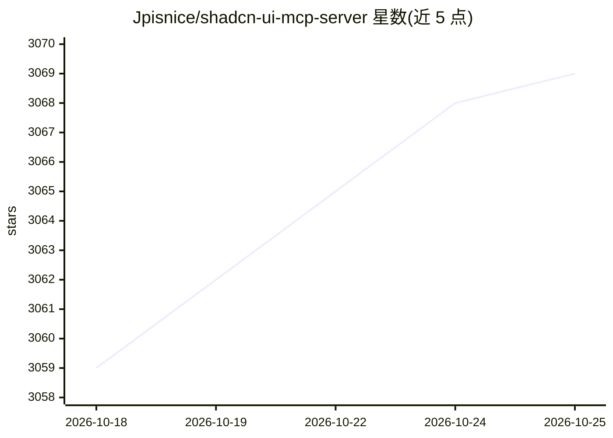

# Jpisnice/shadcn-ui-mcp-server

⭐ 3,069 · TypeScript · MIT · 推送 2026-10-03 · [GitHub](https://github.com/Jpisnice/shadcn-ui-mcp-server) · 个人维护

**向 AI 助手提供 shadcn/ui 组件源码与元数据的 MCP 服务器**

基于 Model Context Protocol（2026-07-28 规范）的服务器，通过 GitHub API 向 AI 助手提供 shadcn/ui v4 组件的 TypeScript 源码、示例、blocks 及依赖元数据，覆盖 React、Svelte、Vue、React Native 四种实现。支持 stdio 与无状态 Streamable HTTP 传输，可用 Docker 部署；带 GitHub API 速率限制处理与缓存。通过 npx 或 npm 全局安装运行，需 Node.js ≥ 20，GitHub token 为可选配置。

## 筛选速览

| 维度 | 判定 | 备注 |
|---|---|---|
| AI 角色 | `ai-ecosystem` | LLM/agent 周边工具 |
| 许可风险 | `permissive` | MIT |
| 部署形态 | `self-host` | docker 或自建部署 |
| 模型依赖 | — | README 未给出锁定关系 |
| 硬件要求 | — | 无带数字的原话,不猜 |
| 安装摩擦 | `low` | 无编译、无系统依赖或容器化 |
| 成熟度 | — | 结构信号不足 |

## 能力要点

- 提供 React/Svelte/Vue/React Native 四种框架的组件源码与元数据访问
- stdio/HTTP/dual 三种传输模式，无状态 /mcp 端点支持多客户端部署
- Docker 与 Docker Compose 部署支持
- Claude Desktop 一键安装（.mcpb 文件）与 Claude Code/VS Code/Cursor 等编辑器集成文档

## 适用场景

- 让 AI 编程助手在写界面时获取准确的 shadcn/ui 组件用法与依赖
- 在编辑器（Claude Code/Cursor/VS Code）中接入组件目录浏览与代码生成
- 生产环境用 HTTP 模式为多个客户端并发提供组件上下文

## 场景标签

 · 领域:开发工具/前端组件

## 证据(README 行号)

> L11: A Model Context Protocol (MCP) server that provides AI assistants with comprehensive access to shadcn/ui v4 compone
> L191: - **AI-Powered Development** - Let AI assistants build UIs with shadcn/ui

## 星数曲线

2026-10-18 3,059 → 2026-10-25 3,069（+10）

---
*卡片 v1 · prompt 1.4 · 生成 2026-10-20 · 置信度 high · 依据 README sha `20bde24caf6e` · [字段定义](../../DATASET.md)*
